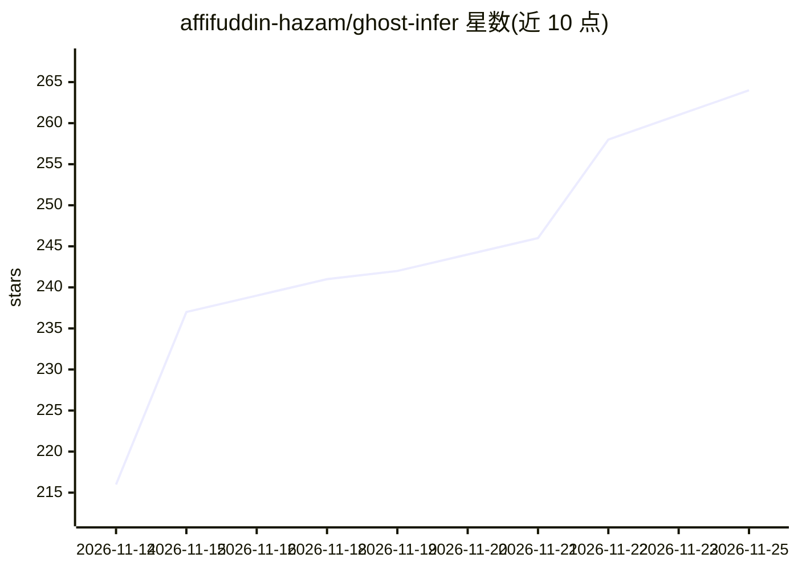

# affifuddin-hazam/ghost-infer

⭐ 264 · HTML · Apache-2.0 · 推送 2026-11-19 · [GitHub](https://github.com/affifuddin-hazam/ghost-infer) · 个人维护

**单二进制本地 LLM 推理引擎：在消费级 NVIDIA GPU 上跑 GGUF 模型**

用 Rust 编写的本地 LLM 推理程序，读取 GGUF 模型文件，在 NVIDIA 显卡上运行，同时提供 OpenAI 兼容的 /v1/chat/completions 服务（含流式与工具调用）和内置聊天页面，另附 Windows 桌面应用（文件代理、语音通话、中英文界面）。面向单用户、单消费级 GPU、单模型的场景；通过把 MoE 专家保留在内存、GPU 缓存常用专家来运行超出显存的模型，并支持精确投机解码。仅支持 Windows 与 NVIDIA GPU（GTX 10 系起），需 AVX2 CPU。

## 筛选速览

| 维度 | 判定 | 备注 |
|---|---|---|
| AI 角色 | `ai-ecosystem` | LLM/agent 周边工具 |
| 许可风险 | `permissive` | Apache-2.0 |
| 部署形态 | `None` |  |
| 模型依赖 | — | README 未给出锁定关系 |
| 硬件要求 | — | 无带数字的原话,不猜 |
| 安装摩擦 | `high` | 编译与系统依赖俱全 |
| 成熟度 | — | 结构信号不足 |

## 能力要点

- 单个 3.8 MB 二进制文件，无 Python、无 pip、无 Docker
- MoE 专家驻留 RAM、GPU 缓存热点专家，可在 8 GB 显存上运行 16.8 GB 模型
- OpenAI 兼容 API（流式与工具调用），编辑器插件与 agent 框架可直连
- 精确投机解码（lookup 与 --draft 小模型），桌面应用支持夜间 LoRA 学习（实验性）

## 适用场景

- 在消费级 NVIDIA 显卡上本地运行比显存更大的 GGUF 模型
- 为编辑器插件、聊天应用和 agent 框架提供本地 OpenAI 兼容 API
- 让模型在桌面应用中读写本地文件并执行命令
- Windows 单机环境下载即用的本地聊天与语音对话

## 场景标签

`推理引擎` `语音 Agent` `聊天机器人` · 领域:对话与助手

## 证据(README 行号)

> L8:  One small Rust program that runs GGUF models on an NVIDIA card, serves an OpenAI-compatible API,
> L81: An OpenAI-compatible `/v1/chat/completions` with streaming and tool calls, so editor plugins, chat apps and agent
> L88: One 3.8 MB file with two Rust dependencies: no Python, no Docker. It compiles its GPU code for your card on first

## 星数曲线

2026-11-14 216 → 2026-11-25 264（+48）

---
*卡片 v1 · prompt 1.4 · 生成 2026-11-25 · 置信度 high · 依据 README sha `48c469a5e399` · [字段定义](../../DATASET.md)*
