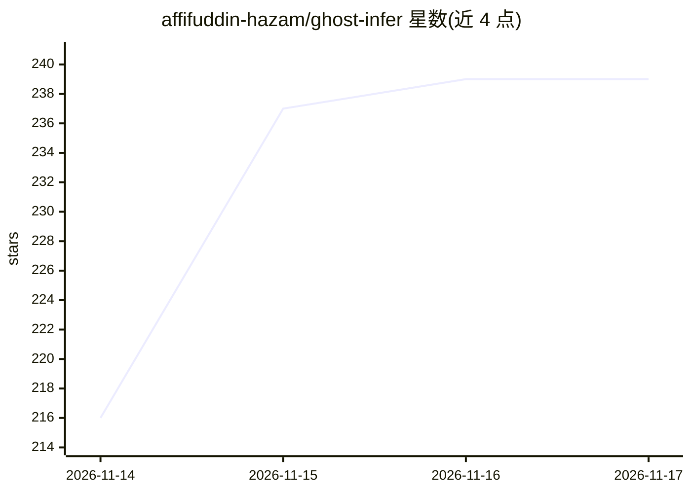

# affifuddin-hazam/ghost-infer

⭐ 239 · HTML · Apache-2.0 · 推送 2026-11-16 · [GitHub](https://github.com/affifuddin-hazam/ghost-infer) · 个人维护 · 中文 README

**消费级 NVIDIA GPU 上的本地 GGUF 推理引擎，含桌面应用**

单个 Rust 二进制的本地 LLM 推理程序：读取 GGUF 模型，在 NVIDIA 消费级显卡上运行，提供 OpenAI 兼容的 /v1/chat/completions 服务（支持流式与工具调用）和聊天页面。核心机制包括 MoE 模型的显存/内存分层（专家驻留 RAM、热点专家缓存到 GPU）、tensor core 注意力、投机解码。附 Windows 桌面应用：文件读写与命令执行的 agent、语音通话（Whisper 等）、夜间 LoRA 记忆训练（实验性、仅源码）。限制：仅 Windows 10/11、NVIDIA GTX 10 系及以上、需 AVX2；基准为作者自测。

## 筛选速览

| 维度 | 判定 | 备注 |
|---|---|---|
| AI 角色 | `ai-ecosystem` | LLM/agent 周边工具 |
| 许可风险 | `permissive` | Apache-2.0 |
| 部署形态 | `None` |  |
| 模型依赖 | — | README 未给出锁定关系 |
| 硬件要求 | — | 无带数字的原话,不猜 |
| 安装摩擦 | `high` | 编译与系统依赖俱全 |
| 成熟度 | `idea` | |

## 能力要点

- MoE 模型超过显存大小时仍可运行：专家驻留 RAM，热点专家缓存至 GPU
- OpenAI 兼容 /v1/chat/completions，支持流式与工具调用
- 投机解码（lookup 默认开启 / --draft 小模型）输出与贪心解码一致
- 桌面应用含文件 agent、语音通话与夜间 LoRA 训练（实验性）

## 适用场景

- 在 8 GB 消费级显卡上跑大于显存的 MoE 模型
- 让编辑器插件、聊天应用等 OpenAI 客户端指向本地推理服务
- 通过桌面应用让模型读写本地文件并运行命令

## 场景标签

`推理引擎` · 领域:训练与推理

## 证据(README 行号)

> L6:  One small Rust program that runs GGUF models on an NVIDIA card, serves an OpenAI-compatible API,
> L84:  Instead of Python, pip packages, a CUDA toolkit and Docker: one 3.8 MB file with two dependencies that starts a se

## 星数曲线

2026-11-14 216 → 2026-11-17 239（+23）

---
*卡片 v1 · prompt 1.4 · 生成 2026-11-17 · 置信度 high · 依据 README sha `457f963ff6ce` · [字段定义](../../DATASET.md)*
