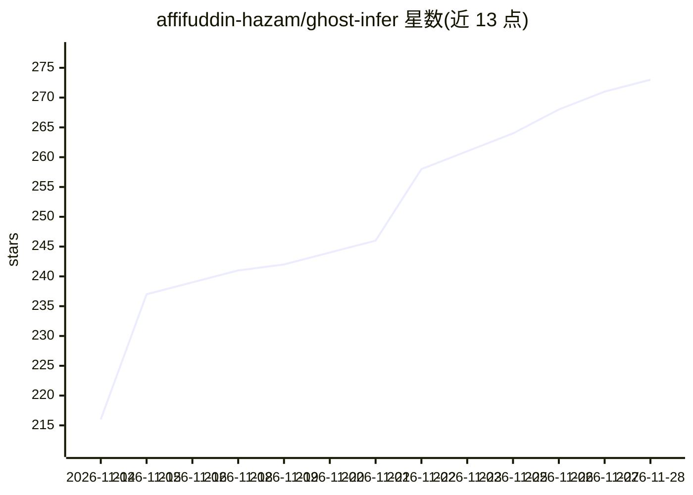

# affifuddin-hazam/ghost-infer

⭐ 273 · Rust · Apache-2.0 · 推送 2026-11-24 · [GitHub](https://github.com/affifuddin-hazam/ghost-infer) · 个人维护

**单消费者 GPU 上的本地 GGUF LLM 推理运行时，含 OpenAI 兼容服务**

单个 Rust 二进制程序，在 NVIDIA 消费级 GPU 上运行 GGUF 模型，提供 OpenAI 兼容的 /v1/chat/completions 服务（流式与工具调用）及 Windows 桌面应用。针对单用户、单 GPU、单模型场景设计：注意力放 GPU、MoE 专家放 RAM 并做 GPU 缓存，支持推测解码与张量核心加速。桌面应用含文件 agent、语音通话与夜间 LoRA 训练（实验性，需源码构建）。

## 筛选速览

| 维度 | 判定 | 备注 |
|---|---|---|
| AI 角色 | `ai-ecosystem` | LLM/agent 周边工具 |
| 许可风险 | `permissive` | Apache-2.0 |
| 部署形态 | `None` |  |
| 模型依赖 | — | README 未给出锁定关系 |
| 硬件要求 | — | 无带数字的原话,不猜 |
| 安装摩擦 | `high` | 编译与系统依赖俱全 |
| 成熟度 | — | 结构信号不足 |

## 能力要点

- MoE 模型专家驻留 RAM、GPU 缓存热点专家，超显存模型可运行
- OpenAI 兼容 API（流式与工具调用），现有客户端无需改动
- 精确推测解码（lookup 与 draft 模型），输出与普通贪心解码一致
- 单 3.8 MB 二进制，无 Python 与 Docker 依赖

## 适用场景

- 在 8 GB 消费级显卡上运行超过显存大小的 MoE 模型
- 为编辑器插件、聊天应用和 agent 框架提供本地 OpenAI 兼容后端
- 桌面端让模型读写本地文件、运行命令完成编码任务

## 场景标签

`推理引擎` · 领域:训练与推理

## 证据(README 行号)

> L8:  One small Rust program that runs GGUF models on an NVIDIA card, serves an OpenAI-compatible API,
> L81: An OpenAI-compatible `/v1/chat/completions` with streaming and tool calls, so editor plugins, chat apps and agent

## 星数曲线

2026-11-14 216 → 2026-11-28 273（+57）

---
*卡片 v1 · prompt 1.4 · 生成 2026-11-26 · 置信度 high · 依据 README sha `e333ed24a51e` · [字段定义](../../DATASET.md)*
