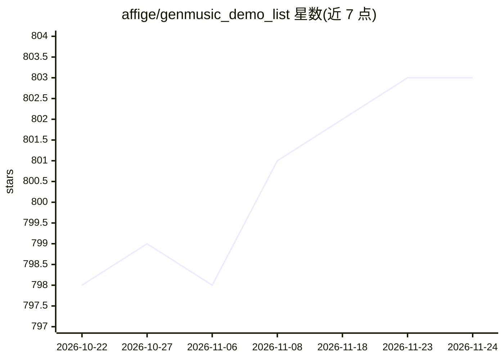

# affige/genmusic_demo_list

⭐ 803 · 推送 2026-11-11 · [GitHub](https://github.com/affige/genmusic_demo_list) · 个人维护

**自动音乐生成研究演示网站清单**

面向自动音乐生成研究的演示网站聚合清单，按子任务分类组织条目，涵盖歌词到歌曲（人声+伴奏）等方向的模型项目链接与论文出处。条目以论文（如 ACL 会议）与对应 GitHub 仓库的形式罗列，供研究者浏览各模型生成的音乐示例。README 仅提供索引信息，不包含安装或运行说明。

## 筛选速览

| 维度 | 判定 | 备注 |
|---|---|---|
| AI 角色 | `ai-knowledge` | 知识聚合/清单类 |
| 许可风险 | `none` | — |
| 部署形态 | `None` |  |
| 模型依赖 | — | README 未给出锁定关系 |
| 硬件要求 | — | 无带数字的原话,不猜 |
| 安装摩擦 | `low` | 无编译、无系统依赖或容器化 |
| 成熟度 | — | 结构信号不足 |

## 能力要点

- 按子任务分类的自动音乐生成演示网站索引
- 条目附论文出处（如 ACL 2026）与 GitHub 仓库链接
- 覆盖歌词到歌曲（vocal+backing）生成方向

## 适用场景

- 查找音乐生成模型的在线演示试听效果
- 调研自动音乐生成研究的代表性工作

## 场景标签

`精选清单` · 领域:学习与行业

## 证据(README 行号)

> L1: ```A list of demo websites for automatic music generation research```
> L3: ### song generation; lyrics-to-song (vocal+backing)

## 星数曲线



2026-10-22 798 → 2026-11-24 803（+5）


---
*卡片 v1 · prompt 1.4 · 生成 2026-11-24 · 置信度 high · 依据 README sha `8924d2c18135` · [字段定义](../../DATASET.md)*
