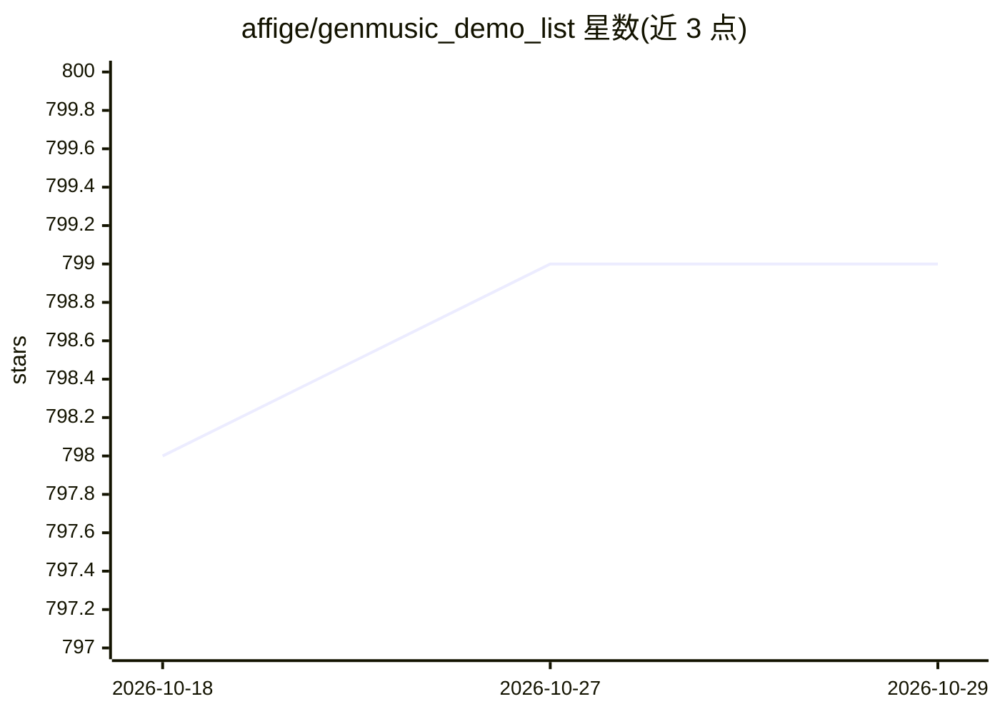

# affige/genmusic_demo_list

⭐ 799 · 推送 2026-10-28 · [GitHub](https://github.com/affige/genmusic_demo_list) · 个人维护

**自动音乐生成研究 demo 网站清单**

面向自动音乐生成研究者的链接清单仓库：按任务分类整理各研究的 demo 网站与模型链接（如歌词成曲等类别），条目附 arXiv 论文地址与 Hugging Face 模型页。内容为纯策展清单，不含代码实现，不提供安装运行方式。

## 筛选速览

| 维度 | 判定 | 备注 |
|---|---|---|
| AI 角色 | `ai-knowledge` | 知识聚合/清单类 |
| 许可风险 | `none` | — |
| 部署形态 | `None` |  |
| 模型依赖 | — | README 未给出锁定关系 |
| 硬件要求 | — | 无带数字的原话,不猜 |
| 安装摩擦 | `low` | 无编译、无系统依赖或容器化 |
| 成熟度 | — | 结构信号不足 |

## 能力要点

- 按任务类别组织（如歌词成曲 vocal+backing）
- 条目附 arXiv 论文链接与 Hugging Face 模型页

## 适用场景

- 查找音乐生成各研究方向可试用的 demo 网站
- 按任务类别浏览自动音乐生成研究进展

## 场景标签

`精选清单` · 领域:学习与行业

## 证据(README 行号)

> L1: ```A list of demo websites for automatic music generation research```
> L3: ### song generation; lyrics-to-song (vocal+backing)

## 星数曲线



2026-10-18 798 → 2026-10-29 799（+1）


---
*卡片 v1 · prompt 1.4 · 生成 2026-10-21 · 置信度 mid · 依据 README sha `bf97c4dba3d4` · [字段定义](../../DATASET.md)*
