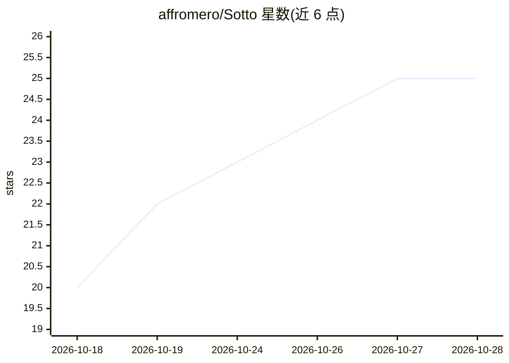

# affromero/Sotto

⭐ 25 · TypeScript · NOASSERTION · 推送 2026-10-27 · [GitHub](https://github.com/affromero/Sotto) · 个人维护

**自托管开源 AI 语言学习平台：围绕个人语境的 CEFR 课程**

自托管的语言学习基础设施：提供覆盖语法、阅读、听力、口语、写作五项分级技能的完整 CEFR 课程，内容由用户连接的 LLM、笔记与兴趣生成。支持 BYOK 接入云厂商或密钥免费的本地 Claude Code/Codex CLI agent，亦可配置本地 LLM/STT/TTS 实现 100% 离线运行。含掌握度门槛的班级推进、SM-2 间隔重复记忆图谱、发音评分、模拟考试与 iPad PDF 练习册。通过 Docker Compose 安装脚本部署，许可证为 PolyForm Noncommercial。

## 筛选速览

| 维度 | 判定 | 备注 |
|---|---|---|
| AI 角色 | `ai-native` | 本体是模型或模型工具 |
| 许可风险 | `none` | NOASSERTION |
| 部署形态 | `desktop` | 安装包/桌面程序 |
| 模型依赖 | local-ok | 支持本地模型 |
| 硬件要求 | — | 无带数字的原话,不猜 |
| 安装摩擦 | `low` | 无编译、无系统依赖或容器化 |
| 成熟度 | — | 结构信号不足 |

## 能力要点

- 五项分级技能的 CEFR 课程，含写作行内纠错与量规发音评分
- SM-2 间隔重复记忆图谱驱动复习与自适应听力内容
- BYOK 或密钥本地 agent（Claude Code/Codex CLI），支持完全离线路径
- 从真实文章/论文/YouTube 链接生成带 [N] 引用的课程

## 适用场景

- 自托管一套完整的语言学习栈，数据与进度归自己
- 在正式开口前私下练习口语、写作与听力
- 让课程基于自己的笔记、工作和兴趣内容生成

## 场景标签

`教程课程` · 领域:学习与行业

## 证据(README 行号)

> L81: A complete CEFR course across **five graded skills**, on a stack you control:
> L97: - **Live conversation:** when you are ready, speak and hear real time translation in either direction through the G

## 星数曲线

2026-10-18 20 → 2026-10-28 25（+5）

---
*卡片 v1 · prompt 1.4 · 生成 2026-10-27 · 置信度 high · 依据 README sha `4266d2b37bf4` · [字段定义](../../DATASET.md)*
