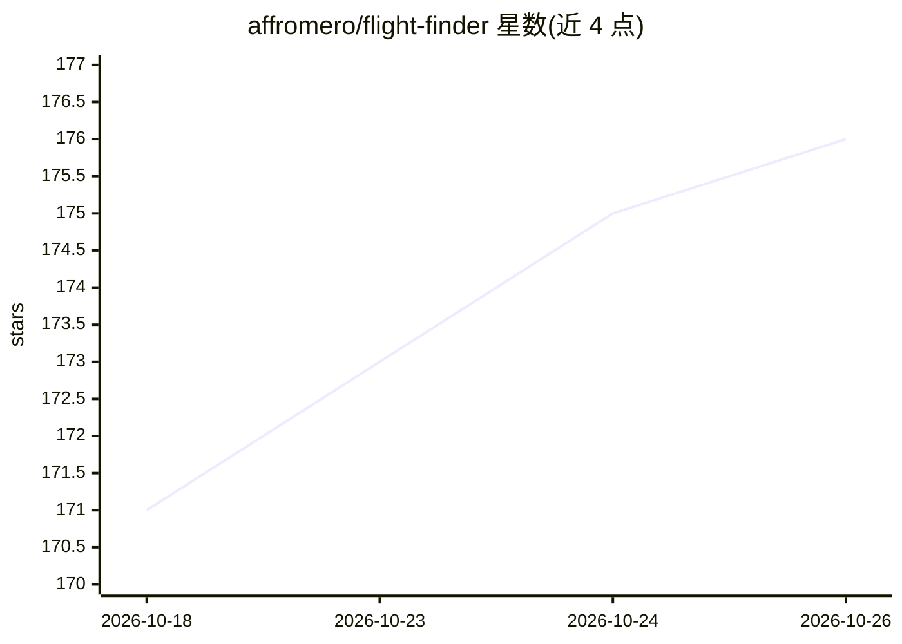

# affromero/flight-finder

⭐ 176 · TypeScript · MIT · 推送 2026-10-24 · [GitHub](https://github.com/affromero/flight-finder) · [官网](https://flight-finder.org) · 个人维护

**自托管机票/酒店/租车价格追踪应用，支持自然语言搜索**

开源自托管 Web/CLI 应用，用 Next.js/TypeScript/Prisma 构建，通过 Playwright 驱动无头 Chromium 抓取 Google Hotels、Booking.com、DiscoverCars、Auto Europe 等来源，追踪机票、酒店、租车价格并记录历史、推送 Pushover 告警。AI 为可选功能：BYOK 自选 AI 提供商用于自然语言搜索（可 100% 本地运行），结构化表单不依赖 AI。提供一键安装脚本、桌面启动器（macOS/Windows/Linux）与 PWA 手机访问，支持多用户家庭模式。不打包机票+酒店+租车为组合行程。

## 筛选速览

| 维度 | 判定 | 备注 |
|---|---|---|
| AI 角色 | `ai-enhanced` | 去掉 AI 部分产品仍成立 |
| 许可风险 | `permissive` | MIT |
| 部署形态 | `self-host` | docker 或自建部署 |
| 模型依赖 | local-ok | 支持本地模型 |
| 硬件要求 | — | 无带数字的原话,不猜 |
| 安装摩擦 | `low` | 无编译、无系统依赖或容器化 |
| 成熟度 | — | 结构信号不足 |

## 能力要点

- 机票/酒店/租车三类独立追踪与价格历史、目标价告警
- BYOK 自选 AI 提供商做自然语言搜索，LLM 100% 本地可行，结构化表单无需 AI
- Playwright 无头 Chromium 抓取 Google Hotels/Booking.com/DiscoverCars/Auto Europe
- 提供 CLI、桌面启动器与 PWA 手机安装，多用户管理与 Pushover 告警

## 适用场景

- 自托管追踪某条航线或酒店的价格并收到降价告警
- 租一辆车时比较不同供应商总价并追踪最便宜报价
- 家庭成员各自管理自己的旅行追踪器

## 场景标签

`网页抓取` · 领域:效率与自动化

## 证据(README 行号)

> L6: Open source. Use your own AI provider for natural-language requests, or search
> L68:  alert and inspect the recorded history. The structured hotel form does not use AI.
> L154: The structured form works without AI. An optional natural-language request

## 星数曲线

2026-10-18 171 → 2026-10-26 176（+5）

---
*卡片 v1 · prompt 1.4 · 生成 2026-10-23 · 置信度 low · 依据 README sha `cd2de2b1111d` · [字段定义](../../DATASET.md)*
