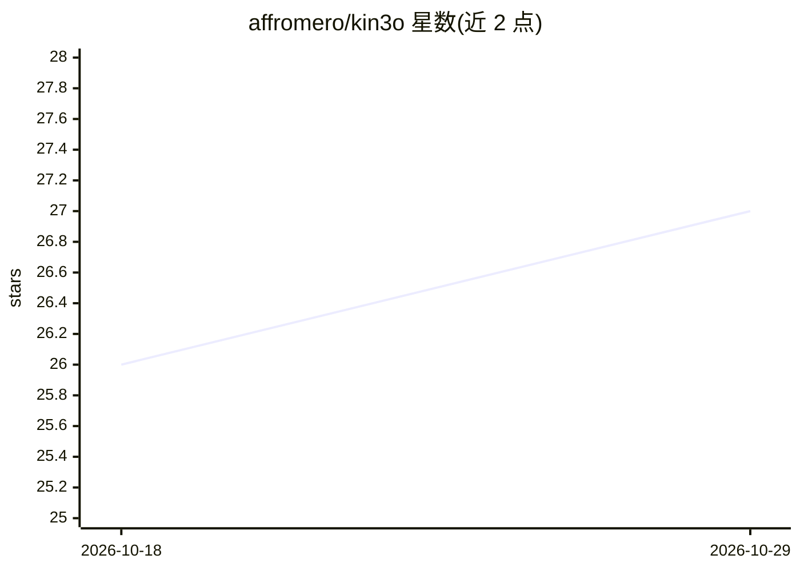

# affromero/kin3o

⭐ 27 · TypeScript · 推送 2026-04-15 · [GitHub](https://github.com/affromero/kin3o) · [官网](https://kin3o.com) · 个人维护

**终端文本生成 Lottie 动画的 AI CLI 工具**

面向开发者的命令行工具：将自然语言 prompt 转为可播放的 Lottie JSON 与交互式 dotLottie 状态机，AI 后端复用已有的 Claude Code/Codex/Anthropic 订阅。生成流程含 JSON 提取、Lottie 校验与自动修复；另支持搜索/下载/发布 LottieFiles 市场动画、浏览器实时预览，export 命令经无头 Chrome 与 FFmpeg 导出 MP4/WebM/GIF（需自装这两个系统依赖）。npm 全局安装或 npx 直接运行，TypeScript 实现，MIT 许可。

## 筛选速览

| 维度 | 判定 | 备注 |
|---|---|---|
| AI 角色 | `ai-native` | 本体是模型或模型工具 |
| 许可风险 | `permissive` | — |
| 部署形态 | `library` | 以包/库形式分发 |
| 模型依赖 | locked-api |  |
| 硬件要求 | — | 无带数字的原话,不猜 |
| 安装摩擦 | `medium` | 含编译或系统依赖之一 |
| 成熟度 | — | 结构信号不足 |

## 能力要点

- prompt 生成 Lottie JSON 与 dotLottie 交互状态机，含校验与自动修复
- 复用已有 Claude Code / Codex / Anthropic 订阅作为 AI 后端
- LottieFiles 市场搜索、下载、AI 精修与发布
- 导出 MP4/WebM/GIF 与本地实时预览（SSE 自动刷新）

## 适用场景

- 在终端从文字描述生成 UI 动画与微交互
- 为 React/iOS/Web 项目生成可直接使用的 Lottie 动画文件
- 搜索下载社区动画并用 AI 精修后发布回市场

## 场景标签

`代码生成` · 领域:编码与开发

## 证据(README 行号)

> L14: AI-powered Lottie animation generator. Turns natural language prompts into valid, playable Lottie JSON and interact
> L55: kin3o generate "pulsing circle that breathes"
> L137: Static:      prompt → generate() → extractJson() → validateLottie() → autoFix() → .json → preview

## 星数曲线

2026-10-18 26 → 2026-10-29 27（+1）

---
*卡片 v1 · prompt 1.4 · 生成 2026-10-26 · 置信度 mid · 依据 README sha `4058c87985a8` · [字段定义](../../DATASET.md)*
