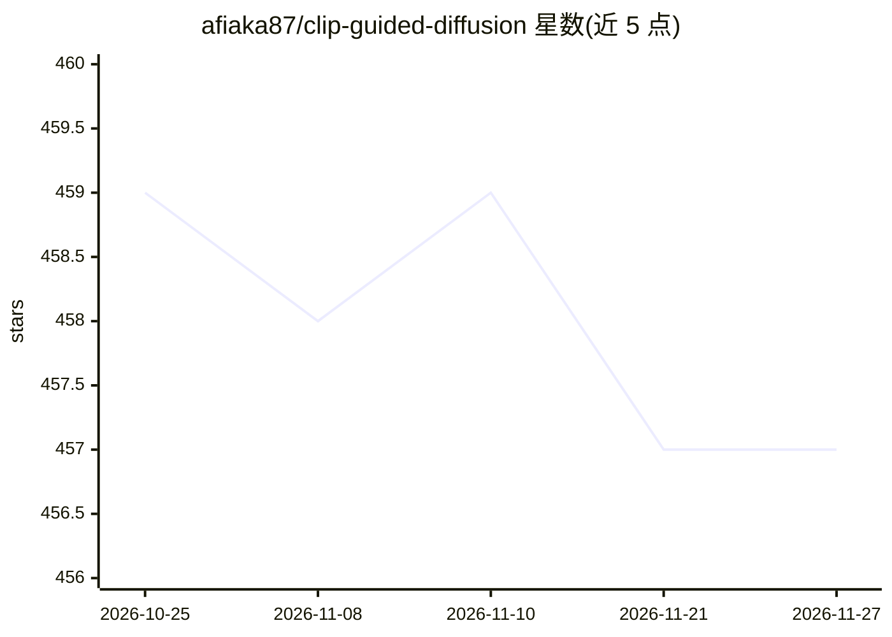

# afiaka87/clip-guided-diffusion

⭐ 457 · Python · MIT · 推送 2026-11-19 · [GitHub](https://github.com/afiaka87/clip-guided-diffusion) · 个人维护

**CLI/Python 模块：用扩散模型+CLIP 从文本生成图像**

源自 @crowsonkb 的文本生成图像工具，以 CLI（cgd 命令）和 Python 模块两种形式提供。经典管线为 ImageNet 扩散模型加 CLIP 引导，可选 sd-turbo 等现代 backbone；支持多提示词加权、图像提示、图像序列滑动动画（GIF/MP4 导出）、以现有图像为起点的生成，同参数可在同机逐字节复现。动画导出需 FFmpeg；CPU 可运行但耗时更长，GPU 默认走 CUDA。作者声明精力转向 pyglide，bug 修复可能变慢。

## 筛选速览

| 维度 | 判定 | 备注 |
|---|---|---|
| AI 角色 | `ai-native` | 本体是模型或模型工具 |
| 许可风险 | `permissive` | MIT |
| 部署形态 | `None` |  |
| 模型依赖 | — | README 未给出锁定关系 |
| 硬件要求 | — | 无带数字的原话,不猜 |
| 安装摩擦 | `medium` | 含编译或系统依赖之一 |
| 成熟度 | `idea` | |

## 能力要点

- 文本/图像提示生成图像，支持多提示词加权与负权重
- 图像序列（|> 语法）滑移动画，导出 GIF/MP4（H.264）
- --init-image 从现有图像出发，支持 LPIPS 感知损失保持构图
- 同 seed 与参数在同机同库版本下逐字节复现

## 适用场景

- 从文本提示生成 64-512 像素图像
- 制作多张图像之间滑动的循环动画
- 以一张已有图为底图重绘出新构图

## 场景标签

`图像生成` · 领域:内容生成

## 证据(README 行号)

> L24: `uv run cgd -gif -freq 3 -size 256 -clip ViT-B/32+PE-Core-B-16 -n 90 -gl 0.99 -cutn 4 "A monarch butterfly on a pur
> L28: That is the classic pipeline: an ImageNet model steered by CLIP, with no extra dependencies to download. It conditi
> L63: - The prompt, in quotes

## 星数曲线

2026-10-25 459 → 2026-11-27 457（-2）

---
*卡片 v1 · prompt 1.4 · 生成 2026-11-25 · 置信度 high · 依据 README sha `00db62d95498` · [字段定义](../../DATASET.md)*
