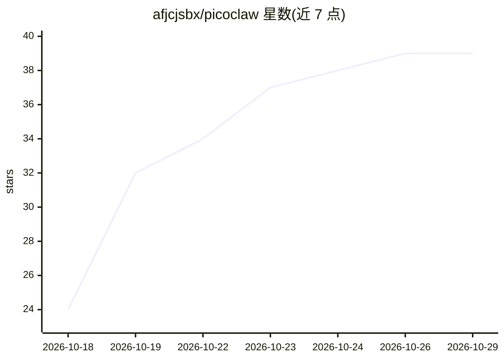

# afjcjsbx/picoclaw

⭐ 39 · Go · MIT · 推送 2026-10-28 · [GitHub](https://github.com/afjcjsbx/picoclaw) · [官网](https://afjcjsbx.github.io/picoclaw/) · 个人维护 · 中文 README

**超轻量自托管个人 AI 助手，可在 RISC-V/开发板/嵌入式运行**

由 Sipeed 发起、用 Go 从零实现的个人 AI 助手（本仓库为其活跃维护分支），核心构建内存占用 10–20 MB，可在 $10 级硬件、RISC-V/ARM/MIPS/x86 及 Android 上以单一二进制运行。功能包括 MCP 协议支持、Agent 插件、多模态视觉输入、基于规则的模型路由、SQLite/FTS5 会话记忆（Seahorse）、30+ LLM provider 接入及 Telegram/Matrix/微信等多渠道。提供 WebUI 配置界面、安装脚本、预编译二进制与 Docker Compose 部署。README 声明项目处于 v1.0 前的早期快速开发阶段，不建议生产部署。

## 筛选速览

| 维度 | 判定 | 备注 |
|---|---|---|
| AI 角色 | `ai-native` | 本体是模型或模型工具 |
| 许可风险 | `permissive` | MIT |
| 部署形态 | `desktop` | 安装包/桌面程序 |
| 模型依赖 | local-ok | 支持本地模型 |
| 硬件要求 | — | 无带数字的原话,不猜 |
| 安装摩擦 | `low` | 无编译、无系统依赖或容器化 |
| 成熟度 | `idea` | |

## 能力要点

- 单一 Go 二进制跨 RISC-V/ARM/MIPS/x86，核心构建 10–20 MB 内存
- 原生 MCP 协议支持与 Agent Plugins 打包安装
- Seahorse 记忆系统：本地 SQLite + FTS5 索引的会话历史与上下文压缩
- 30+ LLM provider 通过 model_list 配置接入，支持多渠道聊天

## 适用场景

- 在低成本开发板（如 LicheeRV、树莓派、NanoKVM）上跑个人 AI 助手
- 通过 Telegram/Matrix/微信等渠道与自托管 agent 对话
- 在嵌入式或边缘设备上部署带记忆与工具能力的 AI 助手

## 场景标签

`AI 助手` · 领域:对话与助手

## 证据(README 行号)

> L26: **PicoClaw** is an ultra-lightweight personal AI assistant inspired by NanoBot. It was rebuilt from the ground up i
> L238: Open the WebUI, then: **1)** Configure a Provider (add your LLM API key) -> **2)** Configure a Channel (e.g., Tele

## 星数曲线

2026-10-18 24 → 2026-10-29 39（+15）

---
*卡片 v1 · prompt 1.4 · 生成 2026-10-25 · 置信度 high · 依据 README sha `adb48544cfbd` · [字段定义](../../DATASET.md)*
