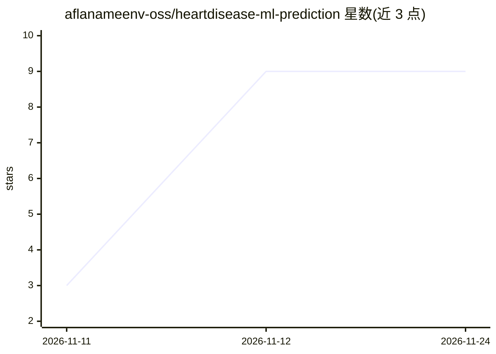

# aflanameenv-oss/heartdisease-ml-prediction

⭐ 9 · Jupyter Notebook · 推送 2026-11-11 · [GitHub](https://github.com/aflanameenv-oss/heartdisease-ml-prediction) · 个人维护

**临床心衰风险预测的监督分类机器学习流水线**

基于 scikit-learn 的端到端监督分类流水线，从临床与 ECG 参数预测心血管疾病。使用 UCI/Kaggle 心衰数据集（918 条记录、12 个临床特征），包含数据清洗（异常零值中位数插补）、统计显著性检验（t 检验、Mann-Whitney U、卡方检验）、防泄漏的 ColumnTransformer 预处理与 5 折分层 GridSearchCV 调参，输出 Gradient Boosting、Logistic Regression 等多模型对比结果。附带 Google Colab notebook 实现。目标为 Recall 与 ROC-AUC ≥ 0.90。

## 筛选速览

| 维度 | 判定 | 备注 |
|---|---|---|
| AI 角色 | `ai-native` | 本体是模型或模型工具 |
| 许可风险 | `none` | — |
| 部署形态 | `None` |  |
| 模型依赖 | — | README 未给出锁定关系 |
| 硬件要求 | — | 无带数字的原话,不猜 |
| 安装摩擦 | `low` | 无编译、无系统依赖或容器化 |
| 成熟度 | — | 结构信号不足 |

## 能力要点

- 防泄漏流水线：ColumnTransformer 预处理嵌入 5 折分层 GridSearchCV
- 统计检验验证特征显著性（Welch t 检验、Mann-Whitney U、卡方检验）
- 四种模型对比的测试集指标（Recall 最高 0.9118，ROC-AUC 最高 0.9350）

## 适用场景

- 复现临床心衰分类的完整建模流程
- 学习特征插补与防泄漏交叉验证的实践方法
- 作为课程项目或教学示例的机器学习参考实现

## 场景标签

`教程课程` · 领域:学习与行业

## 证据(README 行号)

> L3: End-to-end supervised classification pipeline predicting cardiovascular disease from clinical and ECG parameters.
> L13: - **Leak-Free Pipeline:** Built using Scikit-Learn `ColumnTransformer` (median/mode imputation, `StandardScaler`, a

## 星数曲线

2026-11-11 3 → 2026-11-24 9（+6）

---
*卡片 v1 · prompt 1.4 · 生成 2026-11-20 · 置信度 high · 依据 README sha `c2110424f973` · [字段定义](../../DATASET.md)*
