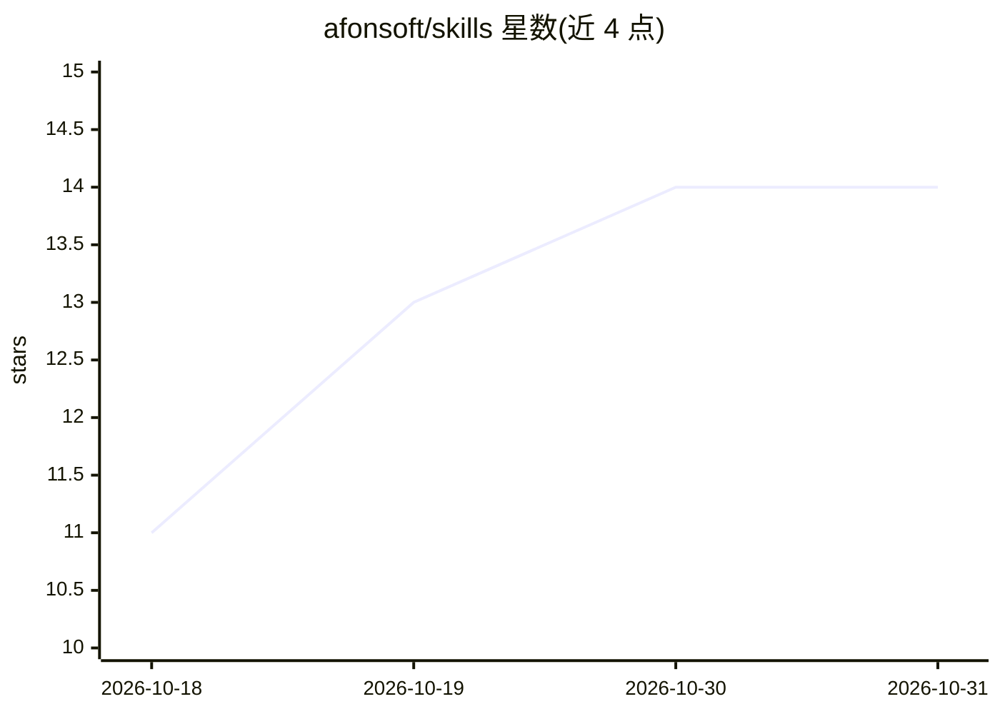

# afonsoft/skills

⭐ 14 · PowerShell · MIT · 推送 2026-10-27 · [GitHub](https://github.com/afonsoft/skills) · [官网](https://skills.sh/afonsoft/skills) · 个人维护

**面向 spec 驱动开发的 Agent Skills 技能库，以 orchestrator 为核心**

遵循 Agent Skills Specification（agentskills.io）的技能集合：orchestrator 技能作为控制循环，将 PRD 或想法转化为批准的 SPEC 文档、GitHub Issues、TDD 实现切片、QA 门禁与已评审的 PR，并可跨 Claude Code、OpenCode、Devin、Cursor 等运行时使用。其余技能按 Harness 工程、编排交付、代码质量、前端设计、扩展集成、MCP 集成六类组织，覆盖架构图生成、逆向工程、SonarQube 修复、WordPress/Composio/NotebookLM MCP 接入等。文档提供英文与葡语版本，附第三方安全审计结果。

## 筛选速览

| 维度 | 判定 | 备注 |
|---|---|---|
| AI 角色 | `ai-ecosystem` | LLM/agent 周边工具 |
| 许可风险 | `permissive` | MIT |
| 部署形态 | `library` | 以包/库形式分发 |
| 模型依赖 | — | README 未给出锁定关系 |
| 硬件要求 | — | 无带数字的原话,不猜 |
| 安装摩擦 | `low` | 无编译、无系统依赖或容器化 |
| 成熟度 | — | 结构信号不足 |

## 能力要点

- orchestrator 控制循环：PRD→SPEC→Issues→TDD 切片→QA→PR，仅在升级门禁处暂停
- 技能按六类组织，含 MCP 服务器构建与多个外部 MCP 集成
- 状态持久化于 .claude/memory/orchestrator_stats.md，阶段间自动推进
- 含 skills.sh 第三方安全审计结果与缓解措施说明

## 适用场景

- 在 Claude Code/Cursor/Devin 等 agent 平台上以 spec 驱动方式开发项目
- 为 AI agent 搭建包含规则、技能与文档的完整 harness
- 让 agent 接入 Composio、NotebookLM、WordPress 等外部服务

## 场景标签

`编码 Agent` · 领域:编码与开发

## 证据(README 行号)

> L19: This repository implements **Spec-Driven Development (SDD)** for AI agents, following the **Agent Skills Specificat
> L21: Every other skill in the catalog is a delegation target in that loop. Instead of generic prompts, each skill provid

## 星数曲线

2026-10-18 11 → 2026-10-31 14（+3）

---
*卡片 v1 · prompt 1.4 · 生成 2026-10-31 · 置信度 mid · 依据 README sha `ffec95fe9a3f` · [字段定义](../../DATASET.md)*
