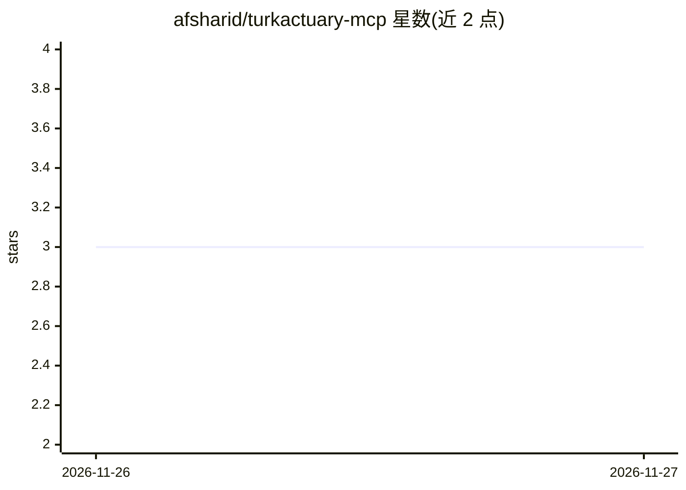

# afsharid/turkactuary-mcp

⭐ 3 · Python · Apache-2.0 · 推送 2026-11-26 · [GitHub](https://github.com/afsharid/turkactuary-mcp) · 个人维护

**面向土耳其保险/精算从业者的 MCP 服务器：法规检索与精算计算**

一个 Model Context Protocol 服务器，提供两类工具：土耳其保险法规检索（5684 号法、规章、16 份教学笔记、49 份最高法院判决，共 827 个片段；有本地 embedding 模型时用 BM25+Qwen3 混合检索，否则退回 BM25）与 16 个精算/赔偿计算器（Decimal 精确运算、含单元测试）。任何支持 MCP 的客户端（LM Studio、Claude Code、Codex、VS Code、Claude Desktop、Cursor）均可接入；通过 uvx/pip/git clone 三种方式安装，Python 3.11+ 且无额外依赖，服务器不出网、不写文件。

## 筛选速览

| 维度 | 判定 | 备注 |
|---|---|---|
| AI 角色 | `ai-ecosystem` | LLM/agent 周边工具 |
| 许可风险 | `permissive` | Apache-2.0 |
| 部署形态 | `library` | 以包/库形式分发 |
| 模型依赖 | — | README 未给出锁定关系 |
| 硬件要求 | — | 无带数字的原话,不猜 |
| 安装摩擦 | `low` | 无编译、无系统依赖或容器化 |
| 成熟度 | — | 结构信号不足 |

## 能力要点

- 法规检索：827 个片段，BM25+Qwen3-Embedding-4B 混合检索，无 embedding 模型时自动退回 BM25
- 16 个精算与赔偿计算器（chain ladder、BF、GLM、年金、Yargıtay 实践赔偿），Decimal 运算且经测试
- 内置 turkactuary prompt 系统指令，要求模型引用来源并用工具计算
- uvx 免安装运行，服务器无网络访问、不下载模型、不写文件

## 适用场景

- 在 MCP 客户端中检索土耳其保险法规条文与最高法院判决
- 计算准备金（chain ladder/BF）、组合指标与 GLM 定价模型
- 按 Yargıtay 实践计算丧失扶养/劳动能力赔偿并列出假设依据

## 场景标签

`RAG` `金融量化` · 领域:知识与检索

## 证据(README 行号)

> L5: Türkiye sigortacılık mevzuatı araması ve aktüeryal hesap araçları için bir **MCP sunucusu**.
> L6: İstediğiniz modeli ya da ajanı kullanın: LM Studio, Claude Code, Codex, VS Code, Claude Desktop, Cursor ve MCP deste
> L61: ## Kurulum

## 星数曲线

2026-11-26 3 → 2026-11-27 3（+0）

---
*卡片 v1 · prompt 1.4 · 生成 2026-11-26 · 置信度 high · 依据 README sha `dc218d250718` · [字段定义](../../DATASET.md)*
