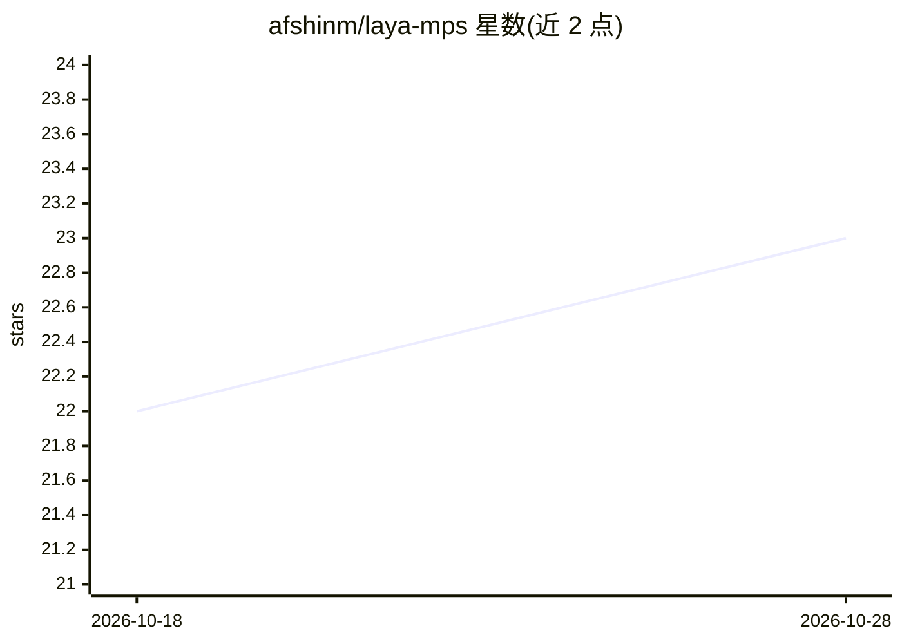

# afshinm/laya-mps

⭐ 23 · Python · MIT · 推送 2026-09-21 · [GitHub](https://github.com/afshinm/laya-mps) · 个人维护

**在 Mac 本地运行 Jev 式类型化决策模型的服务器与 CLI**

基于 PyTorch MPS（Metal GPU）在 Apple Silicon Mac 上本地运行 Laya 类型化决策模型：通过 HTTP 服务器或 CLI 输出 choice（选项）、score（分级评分）、noul（真值概率）三类带概率与置信度的决策答案。默认模式约 2.1 GiB 内存、32 ms 中位延迟，minimal 模式约 0.74 GiB；模型专攻客服、发票、安全事件与 agent 轨迹，非通用语言模型。通过 git clone 与 uv 安装运行，支持离线推理。限制：一次仅一条推理，非 Jev 直接兼容端点。

## 筛选速览

| 维度 | 判定 | 备注 |
|---|---|---|
| AI 角色 | `ai-native` | 本体是模型或模型工具 |
| 许可风险 | `permissive` | MIT |
| 部署形态 | `library` | 以包/库形式分发 |
| 模型依赖 | — | README 未给出锁定关系 |
| 硬件要求 | — | 无带数字的原话,不猜 |
| 安装摩擦 | `low` | 无编译、无系统依赖或容器化 |
| 成熟度 | — | 结构信号不足 |

## 能力要点

- 三档内存模式（0.74/2.11/2.30 GiB），minimal 模式从磁盘流式加载层权重
- choice/score/noul 三种类型化决策输出，附概率与置信度
- 本地 HTTP API（无需 API key）+ CLI 评估 + Pong 延迟基准演示
- 支持完全离线启动（UV_OFFLINE/HF_HUB_OFFLINE）

## 适用场景

- 在 Mac 上离线运行类型化决策模型做客服工单分派或安全事件判定
- 为 agent 流程提供低内存的本地选项/评分/真假判定服务
- 测量和复现本地模型推理延迟与内存占用

## 场景标签

`推理引擎` · 领域:训练与推理

## 证据(README 行号)

> L13: Laya typed-decisions
> L14: chooses options, scores inputs, and estimates whether statements are true. The
> L134: Responses contain `model` and typed `answers`. `choice` selects a label, `noul`

## 星数曲线

2026-10-18 22 → 2026-10-28 23（+1）

---
*卡片 v1 · prompt 1.4 · 生成 2026-10-27 · 置信度 mid · 依据 README sha `befea436b360` · [字段定义](../../DATASET.md)*
