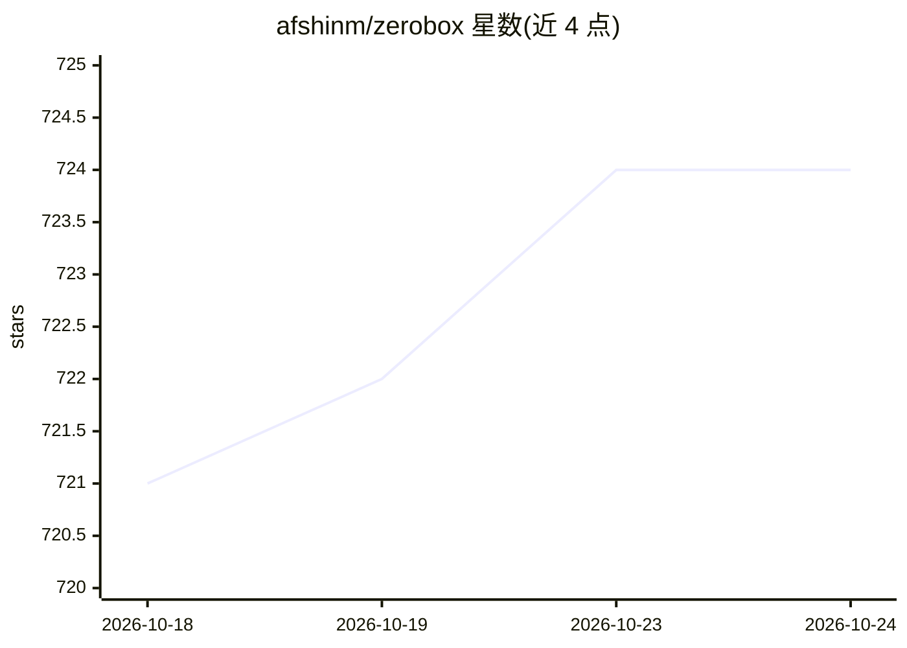

# afshinm/zerobox

⭐ 724 · Rust · Apache-2.0 · 推送 2026-05-17 · [GitHub](https://github.com/afshinm/zerobox) · 个人维护

**跨平台进程沙箱工具：以文件/网络/凭据管控运行任意命令**

基于 OpenAI Codex 沙箱运行时的轻量级进程沙箱：默认拒绝写入、网络与环境变量继承，通过 CLI 标志按路径放行文件读写、按域名放行出站流量；凭据以占位符注入、仅在代理层对获批主机替换真实值，沙箱内进程不可见。支持快照记录与回滚文件变更，提供 Rust/TypeScript/Python SDK。后端为 macOS Seatbelt 与 Linux Bubblewrap+Seccomp+Namespaces，Windows 计划支持；单二进制，宣称约 10ms 开销、无需 Docker/VM。

## 筛选速览

| 维度 | 判定 | 备注 |
|---|---|---|
| AI 角色 | `ai-ecosystem` | LLM/agent 周边工具 |
| 许可风险 | `permissive` | Apache-2.0 |
| 部署形态 | `library` | 以包/库形式分发 |
| 模型依赖 | — | README 未给出锁定关系 |
| 硬件要求 | — | 无带数字的原话,不猜 |
| 安装摩擦 | `medium` | 含编译或系统依赖之一 |
| 成熟度 | — | 结构信号不足 |

## 能力要点

- 默认拒绝的文件/网络/环境变量访问控制（allow/deny 标志）
- 凭据代理注入：进程只见占位符，真实值仅对获批主机替换
- 快照记录、diff 与回滚文件系统变更
- Rust/TypeScript/Python 三语言 SDK，单一二进制

## 适用场景

- 安全运行 AI 生成的代码，防止文件破坏或数据泄露
- 对 LLM 的工具调用逐个沙箱化，API key 不暴露给沙箱内进程
- 构建/测试时限制网络与写入路径，捕获意外的外部调用

## 场景标签

`网络安全` · 领域:学习与行业

## 证据(README 行号)

> L20: Lightweight, cross-platform process sandboxing powered by OpenAI Codex's sandbox runtime.
> L164: ### Run AI-generated code safely
> L182: - `examples/ai-agent-sandboxed` wraps the entire agent process with secrets so the API key is never visible

## 星数曲线

2026-10-18 721 → 2026-10-24 724（+3）

---
*卡片 v1 · prompt 1.4 · 生成 2026-10-22 · 置信度 high · 依据 README sha `306075782a70` · [字段定义](../../DATASET.md)*
