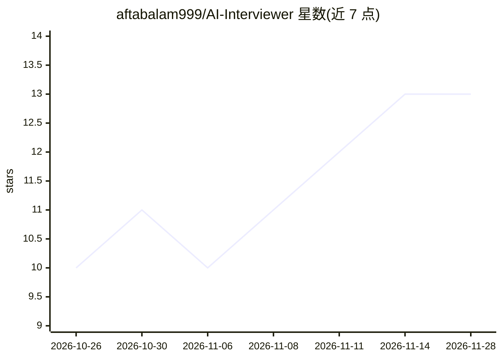

# aftabalam999/AI-Interviewer

⭐ 13 · JavaScript · MIT · 推送 2026-11-13 · [GitHub](https://github.com/aftabalam999/AI-Interviewer) · [官网](https://hiretrack-interview.vercel.app/) · 个人维护

**面向求职者的 AI 模拟面试平台，生成题目并逐题评分反馈**

基于 MERN 栈的全栈应用：用户上传简历与职位描述后，通过 Groq（Llama 3.3）生成技术/行为/情境等多类面试题，Socket.IO 实时追问，每条回答由 AI 评分并给出强弱项反馈；简历经 PDF 文本抽取与 AI 解析，RAG 层用 LangChain 文本切分与 OpenAI embeddings（向量存于内存）。另含独立管理端，管理用户、模板、系统提示词、订阅计划与分析日志。需 MongoDB、Groq 与 OpenAI API key、Cloudinary 账户方可运行。

## 筛选速览

| 维度 | 判定 | 备注 |
|---|---|---|
| AI 角色 | `ai-native` | 本体是模型或模型工具 |
| 许可风险 | `permissive` | MIT |
| 部署形态 | `library` | 以包/库形式分发 |
| 模型依赖 | locked-api |  |
| 硬件要求 | — | 无带数字的原话,不猜 |
| 安装摩擦 | `low` | 无编译、无系统依赖或容器化 |
| 成熟度 | — | 结构信号不足 |

## 能力要点

- 从简历与职位描述生成个性化面试题并逐题 AI 评分
- Socket.IO 实时追问的面试会话
- LangChain + OpenAI embeddings 的 RAG 检索层（内存向量存储）
- 独立管理端覆盖用户、提示词版本、订阅与分析

## 适用场景

- 求职前针对特定岗位做模拟面试练习
- 上传简历后获得逐题评分与改进建议
- 搭建带管理后台的面试练习服务

## 场景标签

`RAG` `文档解析` · 领域:知识与检索

## 证据(README 行号)

> L15: AI Interviewer is a full-stack application for candidates who want to prepare for interviews with realistic, AI-gui
> L66: - Groq SDK for parsing, question generation, evaluation, and follow-ups
> L67: - LangChain and OpenAI embeddings for RAG

## 星数曲线

2026-10-26 10 → 2026-11-28 13（+3）

---
*卡片 v1 · prompt 1.4 · 生成 2026-11-18 · 置信度 high · 依据 README sha `41fd38e4c217` · [字段定义](../../DATASET.md)*
