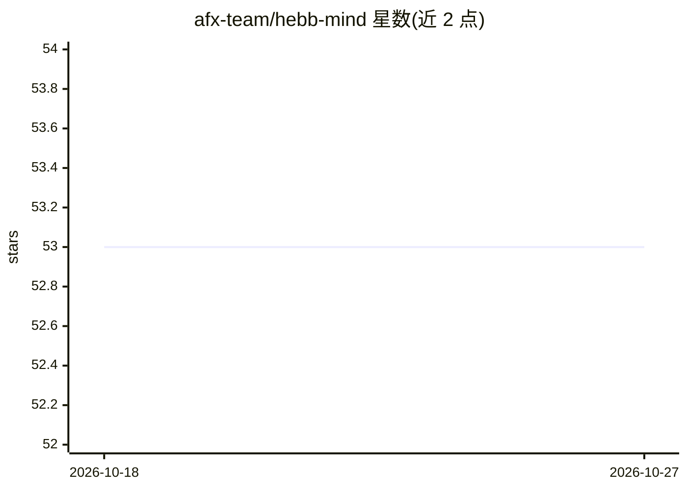

# afx-team/hebb-mind

⭐ 53 · Python · MIT · 推送 2026-08-03 · [GitHub](https://github.com/afx-team/hebb-mind) · [官网](https://afx-team.github.io/hebb-mind/) · 组织维护 · 中文 README

**给 AI agent 的记忆框架：编码→巩固→检索→遗忘闭环**

为 AI agent 提供本地运行的长期记忆系统：以 SQLite 存储、sentence-transformers 嵌入、NetworkX 标签图，实现编码、LLM 驱动的每日巩固（分区分类、冲突消解、标签抽取）、向量+关键词+图三路混合检索，以及基于访问次数与重要度的动态 TTL 遗忘。pipx 一条命令即可启动本地 REST + MCP 端点与 Web 控制台，摄取与检索可完全离线；巩固需配置 LLM 后端（托管 API 或本地 Ollama）。支持 Claude Code 与 Codex 的会话历史同步，提供 Python SDK 进程内使用；可选 PostgreSQL/pgvector 后端。README 含 LoCoMo、LongMemEval、MemBench 基准数据及与 Mem0/Letta/Zep 的功能对比表。MIT 许可。

## 筛选速览

| 维度 | 判定 | 备注 |
|---|---|---|
| AI 角色 | `ai-ecosystem` | LLM/agent 周边工具 |
| 许可风险 | `permissive` | MIT |
| 部署形态 | `library` | 以包/库形式分发 |
| 模型依赖 | local-ok | 支持本地模型 |
| 硬件要求 | — | 无带数字的原话,不猜 |
| 安装摩擦 | `low` | 无编译、无系统依赖或容器化 |
| 成熟度 | — | 结构信号不足 |

## 能力要点

- 编码→重放巩固→三路混合检索→动态 TTL 遗忘的四阶段记忆循环
- 零外部服务依赖：SQLite + 本地嵌入模型即可离线完成摄取与检索
- LLM 驱动的每日 18:00 自动巩固：分区、冲突消解、标签写入知识图
- Claude Code / Codex 会话历史 Agent Sync 与内置 Web 控制台

## 适用场景

- 给我的编程 agent 加上跨会话的长期记忆
- 本地自托管运行记忆服务并通过 REST/MCP/SDK 接入
- 同步 Claude Code 与 Codex 的会话历史作为共享记忆中枢

## 场景标签

`Agent 记忆` · 领域:Agent 开发

## 证据(README 行号)

> L12: Hebb Mind gives AI agents a neuroscience-inspired memory loop — **encode → replay → consolidate → forget**. A `pipx
> L63: Use **Agent Sync** in the Web Console to make Hebb Mind the shared memory hub for Claude Code and Codex. It collect

## 星数曲线

2026-10-18 53 → 2026-10-27 53（+0）

---
*卡片 v1 · prompt 1.4 · 生成 2026-10-24 · 置信度 high · 依据 README sha `04bc282f80e9` · [字段定义](../../DATASET.md)*
