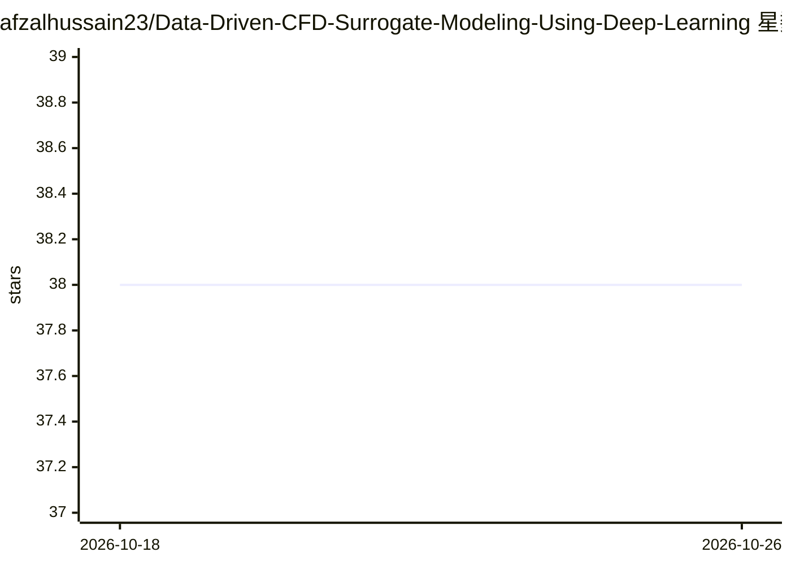

# afzalhussain23/Data-Driven-CFD-Surrogate-Modeling-Using-Deep-Learning

⭐ 38 · Python · MIT · 推送 2026-07-04 · [GitHub](https://github.com/afzalhussain23/Data-Driven-CFD-Surrogate-Modeling-Using-Deep-Learning) · [官网](https://afzalhussain23.github.io/Data-Driven-CFD-Surrogate-Modeling-Using-Deep-Learning/) · 个人维护

**本科生研究项目：用 ConvLSTM 深度学习预测 CFD 流场仿真结果**

机械工程背景的本科研究项目：以 OpenFOAM 对前进台阶超音速流（Ma 3）批量生成约 1500 组变几何仿真（约 168 GB 原始数据），用 Python 脚本自动化建模与数据提取；训练 TimeDistributed Conv2D + ConvLSTM2D（含 ResNet 结构加速收敛）的端到端模型，在未见几何上预测速度、压力、温度随时空的演化。README 为研究报告形式，说明问题设定、数据管线与结果对比，未提供安装或运行入口。

## 筛选速览

| 维度 | 判定 | 备注 |
|---|---|---|
| AI 角色 | `ai-native` | 本体是模型或模型工具 |
| 许可风险 | `permissive` | MIT |
| 部署形态 | `None` |  |
| 模型依赖 | — | README 未给出锁定关系 |
| 硬件要求 | — | 无带数字的原话,不猜 |
| 安装摩擦 | `low` | 无编译、无系统依赖或容器化 |
| 成熟度 | — | 结构信号不足 |

## 能力要点

- Python 脚本自动化生成 1500 组变几何 OpenFOAM 仿真数据集
- TimeDistributed Conv2D + ConvLSTM2D + ResNet 结构预测时空流场
- 在训练中未见的几何上预测激波间断及其时间演化

## 适用场景

- 了解数据驱动方法替代 CFD 仿真计算的完整管线
- 参考变几何批量仿真数据集的自动化生成方式
- 作为流场时空预测的深度学习案例阅读

## 场景标签

 · 领域:计算流体力学/科学机器学习

## 证据(README 行号)

> L7: This January, during the starting of the 7th semester I completed Andrew Ng’s Deep Learning Specialization from Cour
> L35: As fluid simulation is time-dependent I have used three TimeDistributed Conv2D followed by a TimeDistributed MaxPoo

## 星数曲线

2026-10-18 38 → 2026-10-26 38（+0）

---
*卡片 v1 · prompt 1.4 · 生成 2026-10-25 · 置信度 high · 依据 README sha `22cac9b50ebf` · [字段定义](../../DATASET.md)*
