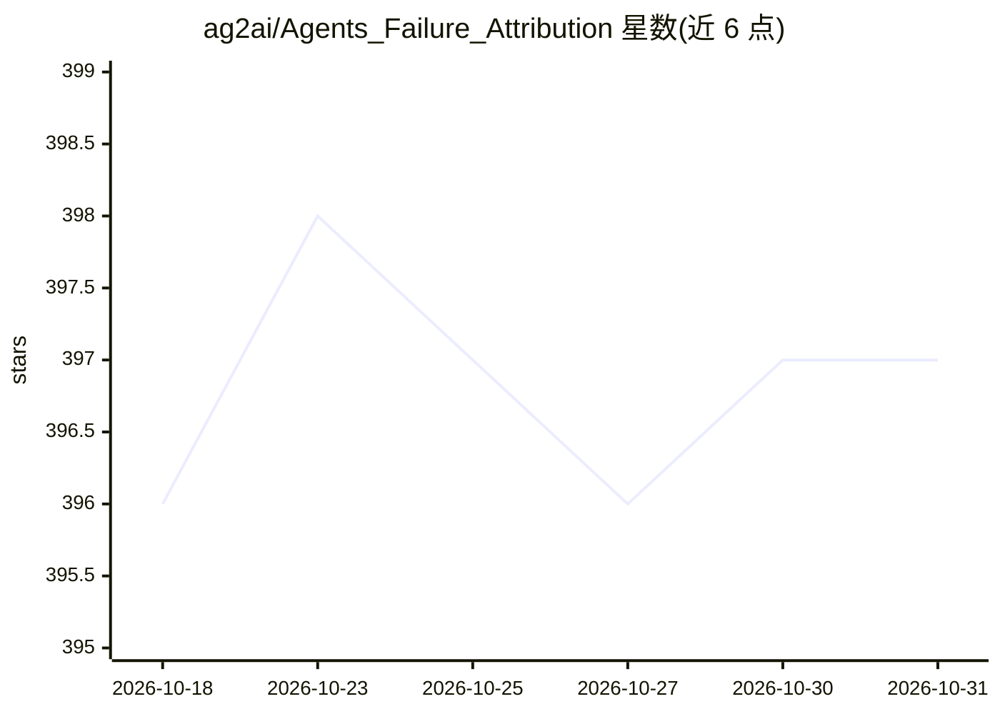

# ag2ai/Agents_Failure_Attribution

⭐ 397 · Python · MIT · 推送 2026-02-11 · [GitHub](https://github.com/ag2ai/Agents_Failure_Attribution) · [官网](https://ag2ai.github.io/Agents_Failure_Attribution/) · 组织维护 · 中文 README

**多智能体系统失败归因的评测基准（ICML 2025）**

ICML 2025 Spotlight 论文《Which Agent Causes Task Failures and When?》的实现：给定失败任务，自动识别多智能体系统中导致失败的 agent 及其关键错误步骤。数据集含 184 个标注失败任务，来源为 CaptainAgent 生成的系统与 Magnetic-One 等手工系统，查询基于 GAIA 与 AssistantBench，每条失败标注责任 agent、决定性错误步骤与自然语言解释。支持 GPT-4o、GPT-4、Llama-3.1、Qwen2.5 等模型，提供 all_at_once/step_by_step/binary_search 三种归因方法的推理与评测脚本。

## 筛选速览

| 维度 | 判定 | 备注 |
|---|---|---|
| AI 角色 | `ai-ecosystem` | LLM/agent 周边工具 |
| 许可风险 | `permissive` | MIT |
| 部署形态 | `library` | 以包/库形式分发 |
| 模型依赖 | — | README 未给出锁定关系 |
| 硬件要求 | — | 无带数字的原话,不猜 |
| 安装摩擦 | `low` | 无编译、无系统依赖或容器化 |
| 成熟度 | — | 结构信号不足 |

## 能力要点

- 184 个标注失败任务，含责任 agent、错误步骤与自然语言解释
- 三种失败归因方法（All-at-Once/Step-by-Step/Binary Search）
- 支持 GPT-4o、GPT-4、Llama-3.1、Qwen2.5 系列模型
- 数据集发布于 Hugging Face

## 适用场景

- 评测 LLM 多智能体系统失败归因方法的效果
- 为 agent 自我改进或强化学习提供错误定位信号
- 研究自动化调试多智能体系统的学术团队复现论文结果

## 场景标签

`模型评测` · 领域:评测与运维

## 证据(README 行号)

> L19: This repository provides the implementation of ICML 2025 spotlight paper "Which Agent Causes Task Failures and When
> L27: ## 🔧 Who&When: #1 Benchmark for MAS **automated failure attribution.**
> L29: - **184** annotated failure tasks collected from

## 星数曲线

2026-10-18 396 → 2026-10-31 397（+1）

---
*卡片 v1 · prompt 1.4 · 生成 2026-10-22 · 置信度 mid · 依据 README sha `d5506bd329ac` · [字段定义](../../DATASET.md)*
