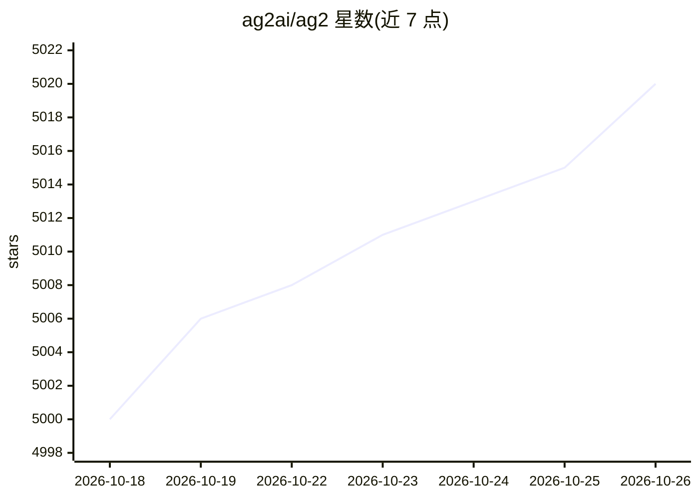

# ag2ai/ag2

⭐ 5,020 · Python · Apache-2.0 · 推送 2026-10-25 · [GitHub](https://github.com/ag2ai/ag2) · [官网](https://ag2.ai) · 组织维护

**构建多 AI agent 的开源编程框架（前 AutoGen）**

面向开发者的多智能体编程框架：核心 Agent 对接模型提供商并调用工具，通过 Network（Hub 与类型化 channels）编排多智能体协作，支持 conversation/consulting/discussion/workflow 四种通道模式；提供 opt-in 的 agent harness（知识存储、上下文组装、历史压缩）、human-in-the-loop、结构化输出、中间件与评测等原语。经典 AutoGen 命名空间已迁至独立仓库 ag2ai/ag2-classic，本包以 `import ag2` 提供 v1.0，非平滑升级。Apache-2.0 许可，由多机构志愿者维护。

## 筛选速览

| 维度 | 判定 | 备注 |
|---|---|---|
| AI 角色 | `ai-ecosystem` | LLM/agent 周边工具 |
| 许可风险 | `permissive` | Apache-2.0 |
| 部署形态 | `library` | 以包/库形式分发 |
| 模型依赖 | local-ok | 支持本地模型 |
| 硬件要求 | — | 无带数字的原话,不猜 |
| 安装摩擦 | `low` | 无编译、无系统依赖或容器化 |
| 成熟度 | — | 结构信号不足 |

## 能力要点

- Network（Hub+类型化 channels）多智能体编排，四种通道模式
- @tool 装饰 Python 函数实现完整工具调用循环
- agent harness：KnowledgeStore 持久知识与 SummarizeCompact 历史压缩
- human-in-the-loop 暂停运行收集人工确认

## 适用场景

- 构建 planner/reviewer 等多智能体协作工作流
- 为 agent 挂载工具与持久记忆开发应用
- 从经典 AutoGen 迁移或并行维护旧代码

## 场景标签

`Agent 框架` `多智能体` · 领域:Agent 开发

## 证据(README 行号)

> L37: AG2 is an open-source programming framework for building AI agents and facilitating cooperation among multiple agen
> L131: - **Agents**: `Agent` is the core building block — it talks to a model provider, calls tools, and returns a reply.
> L173: When two or more agents need to work together, AG2 uses the **Network**: a `Hub` that owns the registry, the write

## 星数曲线

2026-10-18 5,000 → 2026-10-26 5,020（+20）

---
*卡片 v1 · prompt 1.4 · 生成 2026-10-20 · 置信度 high · 依据 README sha `b3336c823322` · [字段定义](../../DATASET.md)*
