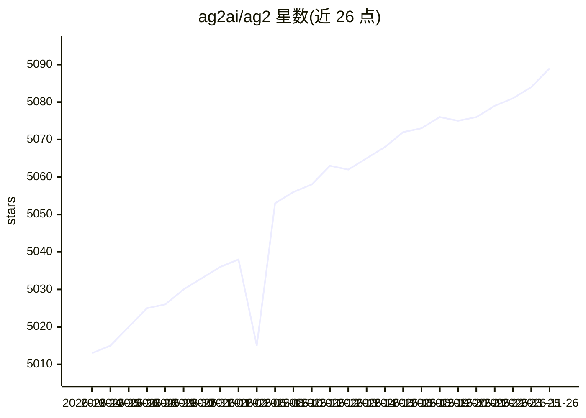

# ag2ai/ag2

⭐ 5,089 · Python · Apache-2.0 · 推送 2026-11-24 · [GitHub](https://github.com/ag2ai/ag2) · [官网](https://ag2.ai) · 组织维护

**构建多智能体协作的开源 Agent 编程框架**

AG2（前身为 AutoGen）是一个用于构建 AI 智能体并协调多智能体协作完成任务的编程框架。核心机制包括：`Agent.ask()` 的异步会话模型、`@tool` 装饰器驱动的完整工具调用循环、`context.input()` 实现的人在回路暂停、基于 Hub 与类型化通道（conversation/consulting/discussion/workflow）的多智能体 Network 编排，以及可选的 harness 原语（KnowledgePlugin 跨运行记忆、SummarizeCompact 历史压缩）。需要 Python >= 3.11；v1.0 与原 Classic 框架不兼容，Classic 已拆分至独立仓库。

## 筛选速览

| 维度 | 判定 | 备注 |
|---|---|---|
| AI 角色 | `ai-ecosystem` | LLM/agent 周边工具 |
| 许可风险 | `permissive` | Apache-2.0 |
| 部署形态 | `library` | 以包/库形式分发 |
| 模型依赖 | local-ok | 支持本地模型 |
| 硬件要求 | — | 无带数字的原话,不猜 |
| 安装摩擦 | `low` | 无编译、无系统依赖或容器化 |
| 成熟度 | — | 结构信号不足 |

## 能力要点

- 多智能体 Network 编排：Hub + 四种类型化通道
- @tool 装饰器自动执行完整工具调用循环
- KnowledgePlugin 跨运行记忆与 SummarizeCompact 历史压缩
- 人在回路：工具内暂停收集人工确认

## 适用场景

- 构建需要多个智能体分工协作的任务流程
- 为智能体接入外部 API 与工具调用
- 搭建带人工审核环节的智能体工作流

## 场景标签

`Agent 框架` `多智能体` `工作流自动化` · 领域:Agent 开发

## 证据(README 行号)

> L37: AG2 is an open-source programming framework for building AI agents and facilitating cooperation among multiple agen
> L131: - **Agents**: `Agent` is the core building block — it talks to a model provider, calls tools, and returns a reply.

## 星数曲线

2026-10-24 5,013 → 2026-11-26 5,089（+76）

---
*卡片 v1 · prompt 1.4 · 生成 2026-11-22 · 置信度 high · 依据 README sha `05e9073fb776` · [字段定义](../../DATASET.md)*
