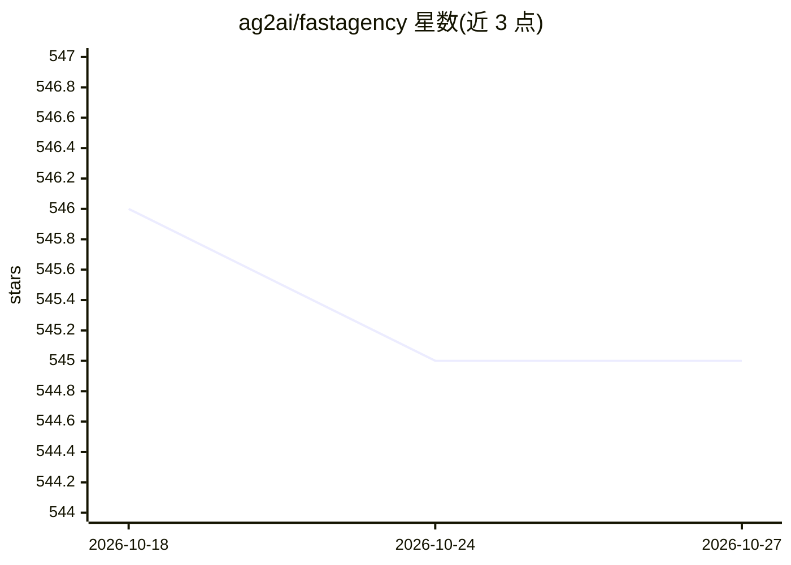

# ag2ai/fastagency

⭐ 545 · Python · Apache-2.0 · 推送 2026-02-23 · [GitHub](https://github.com/ag2ai/fastagency) · [官网](https://fastagency.ai/latest) · 组织维护

**将 AG2 多智能体工作流从原型部署到生产的框架**

面向使用 AG2（原 AutoGen）框架的开发者的部署框架：提供统一编程接口，将同一工作流在 ConsoleUI 命令行或 MesopUI 网页应用中复用；通过 FastAPIAdapter 以 REST API 服务，或经 NatsAdapter 接入 NATS.io 消息队列构建跨机器分布式系统。支持导入 OpenAPI 规范接入外部 API、用于 CI 的 Tester 测试类和 CLI 编排。推荐用 Cookiecutter 生成项目，提供 Docker 镜像构建/运行脚本及 Fly.io 部署脚本。当前唯一支持的运行时是 AG2，计划扩展其他框架。

## 筛选速览

| 维度 | 判定 | 备注 |
|---|---|---|
| AI 角色 | `ai-ecosystem` | LLM/agent 周边工具 |
| 许可风险 | `permissive` | Apache-2.0 |
| 部署形态 | `library` | 以包/库形式分发 |
| 模型依赖 | — | README 未给出锁定关系 |
| 硬件要求 | — | 无带数字的原话,不猜 |
| 安装摩擦 | `low` | 无编译、无系统依赖或容器化 |
| 成熟度 | — | 结构信号不足 |

## 能力要点

- 统一编程接口，同一工作流复用于 Console 与 Mesop 网页界面
- FastAPI REST 与 NATS.io 两种网络适配器，可扩展为分布式部署
- 导入 OpenAPI 规范以数行代码将外部 API 接入智能体工作流
- Tester 测试类支持在 CI 中验证智能体行为

## 适用场景

- 把 Jupyter 里的 AG2 原型扩展为生产可用的 Web 或 REST 服务
- 跨多机多数据中心部署分布式多智能体系统
- 在 CI 中自动测试多智能体工作流

## 场景标签

`多智能体` `Agent 框架` · 领域:Agent 开发

## 证据(README 行号)

> L50: frameworks available today, the most popular open-source one is **AG2** (formerly AutoGen). FastAgency provides you
> L74: Currently, the only supported runtime is **AG2** (formerly AutoGen).

## 星数曲线

2026-10-18 546 → 2026-10-27 545（-1）

---
*卡片 v1 · prompt 1.4 · 生成 2026-10-22 · 置信度 high · 依据 README sha `86558fa8f609` · [字段定义](../../DATASET.md)*
