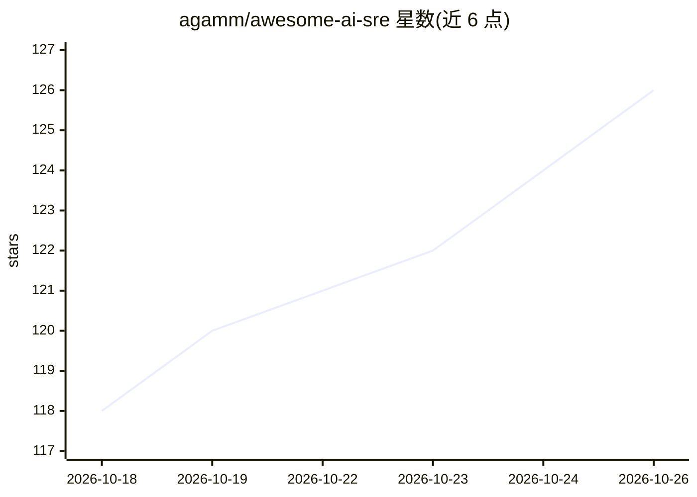

# agamm/awesome-ai-sre

⭐ 126 · CC0-1.0 · 推送 2026-09-23 · [GitHub](https://github.com/agamm/awesome-ai-sre) · [官网](https://github.com/agamm/awesome-ai-sre) · 个人维护

**面向 SRE 的 AI 工具策展清单：收录 100+ 工具与平台**

按类别组织的 AI+SRE 工具清单：覆盖 AI SRE Agent、生产调试、事件管理、可观测性平台、AIOps、日志分析与异常检测、混沌工程、Runbook 自动化等章节，每个条目给出产品名与功能描述。面向希望了解 AI 在站点可靠性工程（自主事件响应、智能可观测性、自愈基础设施）应用的 SRE/DevOps 工程师与团队，作为选型与调研参考。README 顶部含项目收购/合作意向声明。

## 筛选速览

| 维度 | 判定 | 备注 |
|---|---|---|
| AI 角色 | `ai-knowledge` | 知识聚合/清单类 |
| 许可风险 | `viral` | CC0-1.0 |
| 部署形态 | `None` |  |
| 模型依赖 | — | README 未给出锁定关系 |
| 硬件要求 | — | 无带数字的原话,不猜 |
| 安装摩擦 | `low` | 无编译、无系统依赖或容器化 |
| 成熟度 | — | 结构信号不足 |

## 能力要点

- 按 AI SRE Agent、事件管理、可观测性、AIOps、混沌工程等类别组织条目
- 每条目附功能描述，涵盖开源与商业产品
- 覆盖从告警调查、根因分析到自动修复的完整链路工具

## 适用场景

- 调研可自主响应事件的 AI SRE Agent 产品
- 比较各可观测性平台的 AI 能力
- 查找开源 AIOps 与混沌工程工具

## 场景标签

`精选清单` · 领域:学习与行业

## 证据(README 行号)

> L3: > Applying artificial intelligence to site reliability engineering — autonomous incident response, intelligent obser
> L9: ## AI SRE Agents
> L49: ## Incident Management

## 星数曲线

2026-10-18 118 → 2026-10-26 126（+8）

---
*卡片 v1 · prompt 1.4 · 生成 2026-10-23 · 置信度 high · 依据 README sha `b60f9b7451ed` · [字段定义](../../DATASET.md)*
