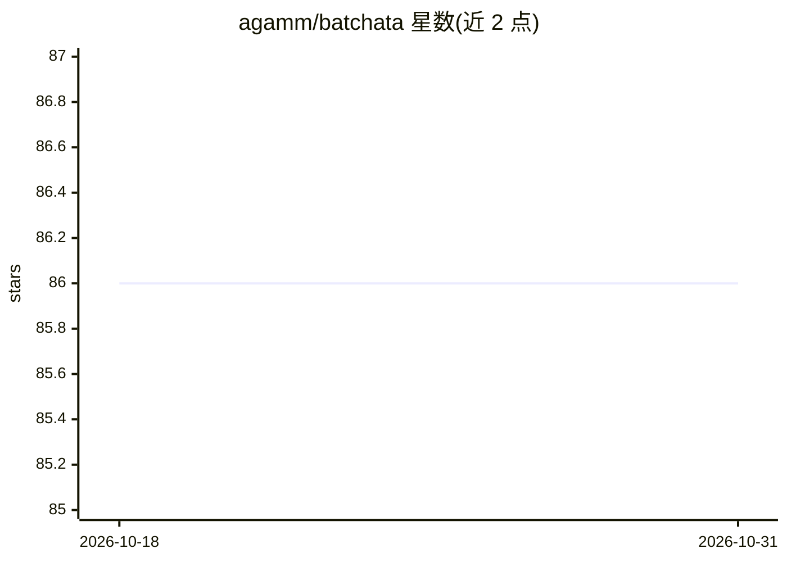

# agamm/batchata

⭐ 86 · Python · 推送 2026-04-28 · [GitHub](https://github.com/agamm/batchata) · [官网](https://agamm.github.io/batchata/) · 个人维护

**统一 Python API 库：跨厂商提交 AI 批量请求并跟踪成本**

面向开发者的 Python 库，封装 Anthropic、OpenAI、Google Gemini 的批量 API：统一接口提交批处理作业，多数厂商批量价 50% 折扣。提供成本上限（max_cost_usd）、dry run 成本估算、时间限制、状态持久化、Pydantic 结构化输出与引用映射（仅 Anthropic）。运行时显示实时进度（作业进度、花费、耗时）。限制：引用映射为启发式且仅支持扁平 Pydantic 模型；成本跟踪需批量完成后才精确。目前处于 beta，会有破坏性变更。

## 筛选速览

| 维度 | 判定 | 备注 |
|---|---|---|
| AI 角色 | `ai-ecosystem` | LLM/agent 周边工具 |
| 许可风险 | `none` | — |
| 部署形态 | `library` | 以包/库形式分发 |
| 模型依赖 | locked-api |  |
| 硬件要求 | — | 无带数字的原话,不猜 |
| 安装摩擦 | `low` | 无编译、无系统依赖或容器化 |
| 成熟度 | `idea` | |

## 能力要点

- 统一封装 Anthropic / OpenAI / Gemini 三家批量 API
- max_cost_usd 成本上限与 dry run 成本估算
- Pydantic 结构化输出与引用字段映射（仅 Anthropic）
- 断网后状态持久化与实时进度显示

## 适用场景

- 离线批量处理大量 LLM 请求并省一半成本
- 为批量任务设成本上限避免超支
- 批量文档处理时把引用映射回源文档

## 场景标签

`模型网关` · 领域:Agent 开发

## 证据(README 行号)

> L5: Unified Python API for AI Batch requests with cost tracking, Pydantic responses, citation mapping and parallel execu
> L13: AI providers offer batch APIs that process requests asynchronously at 50% reduced cost compared to real-time APIs. 
> L24: - Multiple provider support (Anthropic, OpenAI, Google Gemini)

## 星数曲线

2026-10-18 86 → 2026-10-31 86（+0）

---
*卡片 v1 · prompt 1.4 · 生成 2026-10-24 · 置信度 high · 依据 README sha `a4a64a2a6766` · [字段定义](../../DATASET.md)*
