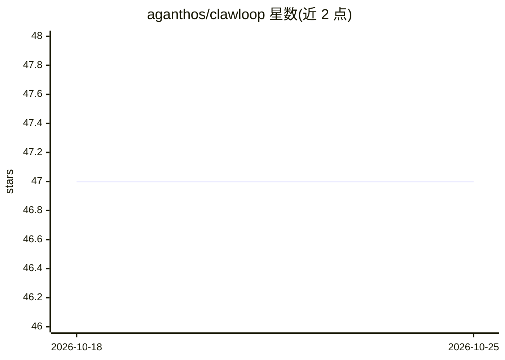

# aganthos/clawloop

⭐ 47 · Python · NOASSERTION · 推送 2026-06-12 · [GitHub](https://github.com/aganthos/clawloop) · [官网](https://aganthos.com) · 组织维护

**让 LLM agent 从经验中学习的训练框架：三层学习闭环**

Python 框架，通过采集 agent 与环境交互的 episode 轨迹，在三个层面将改进回注 agent：harness 层由 LLM reflector 分析失败并提取策略注入 playbook（写入 system prompt、按优劣评分增删）；router 层按查询复杂度优化模型分配；weights 层将 LoRA/SFT/GRPO/PPO 训练委托给 SkyRL/Tinker。三层共用 forward_backward/optim_step 协议并支持跨层回滚。环境可插拔（math/harbor/entropic/openclaw/taubench），LLM 接入经 litellm 支持任意 provider。限制：router 与 weight 层约束较多，harness+weight 同时训练的 mode=full 已禁用，新环境需手动构建 Episode。

## 筛选速览

| 维度 | 判定 | 备注 |
|---|---|---|
| AI 角色 | `ai-ecosystem` | LLM/agent 周边工具 |
| 许可风险 | `none` | NOASSERTION |
| 部署形态 | `library` | 以包/库形式分发 |
| 模型依赖 | — | README 未给出锁定关系 |
| 硬件要求 | — | 无带数字的原话,不猜 |
| 安装摩擦 | `low` | 无编译、无系统依赖或容器化 |
| 成熟度 | `idea` | |

## 能力要点

- harness/router/weights 三层学习共用统一两阶段协议，支持跨层原子回滚
- playbook 策略注入 system prompt，按 helpful/harmful 评分自动留存与剪枝
- 经 litellm 接入任意 LLM provider，环境通过 ENV_BUILDERS 注册表插拔
- 提供无 API key 的 dry-run 数学 demo 与 JSON 配置驱动的基准训练

## 适用场景

- 给现有 LLM agent 套一层包装，从生产轨迹中累积可复用策略
- 在 math/TauBench/CRMArena 等基准上跑配置驱动的 agent 训练
- 对 OpenClaw 实例做零代码改动的代理式学习
- 用 SkyRL/Tinker 配方在 GPU 上做 LoRA/GRPO/PPO 权重训练

## 场景标签

`强化学习` `微调` `Agent 框架` · 领域:Agent 开发

## 证据(README 行号)

> L9: Your AI agents run, fail, and forget. ClawLoop closes the loop: it observes
> L11: into the agent. Three learning layers — **harness**, **router**, **weights** —
> L128: GRPO, PPO, and more — delegating to SkyRL/Tinker

## 星数曲线

2026-10-18 47 → 2026-10-25 47（+0）

---
*卡片 v1 · prompt 1.4 · 生成 2026-10-25 · 置信度 mid · 依据 README sha `38d2fa2ab487` · [字段定义](../../DATASET.md)*
