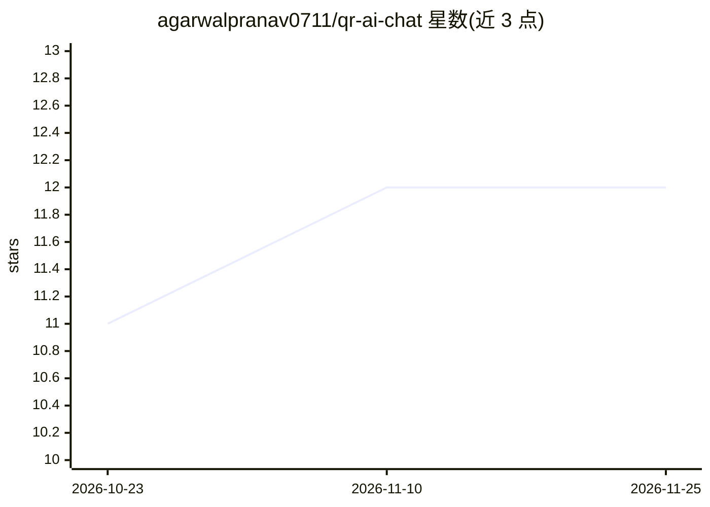

# agarwalpranav0711/qr-ai-chat

⭐ 12 · JavaScript · MIT · 推送 2026-07-10 · [GitHub](https://github.com/agarwalpranav0711/qr-ai-chat) · [官网](https://deploy-phi-mauve.vercel.app) · 个人维护

**把整个 AI 聊天界面压缩进一枚二维码的个人名片项目**

将 HTML/CSS/JS 界面连同 AI 个人上下文经 terser 压缩、gzip、base64 编码后塞进 Version 40 QR 码的 URL hash 中（约 2.7KB），扫码后浏览器本地解压并即时渲染界面；AI 模型不在码内，每次发消息通过一个 Cloudflare Worker 无服务代理调用后端模型。项目提供压缩构建脚本（node widget/build.js）、静态 loader 部署方案，以及 API key 服务端保管、CORS 锁定、限流等安全措施，定位为可 fork 定制的演示项目。

## 筛选速览

| 维度 | 判定 | 备注 |
|---|---|---|
| AI 角色 | `ai-native` | 本体是模型或模型工具 |
| 许可风险 | `permissive` | MIT |
| 部署形态 | `None` |  |
| 模型依赖 | — | README 未给出锁定关系 |
| 硬件要求 | — | 无带数字的原话,不猜 |
| 安装摩擦 | `low` | 无编译、无系统依赖或容器化 |
| 成熟度 | — | 结构信号不足 |

## 能力要点

- 整个聊天界面（含个人上下文）压缩进约 2.7KB 的 QR 码 URL
- 纯 vanilla HTML/CSS/JS，零框架零依赖
- Cloudflare Worker 代理：API key 服务端保管、CORS 锁定、IP 与全局限流
- 压缩流水线：terser 压缩 + Node zlib gzip level 9 + base64 编码

## 适用场景

- 把个人名片/作品集做成可扫码对话的 AI 形象
- 无安装、扫码即用的移动端演示
- fork 后换成自己的身份信息并自建部署

## 场景标签

`聊天机器人` · 领域:对话与助手

## 证据(README 行号)

> L15: Most "AI QR codes" are just a sticker with a link on it — scan it, get redirected to a normal hosted webpage. **Thi
> L17: Then it talks to a real AI — not a canned FAQ bot — that answers questions about the person it represents.
> L30: The interface lives inside the QR code. The AI model itself does not — that's not a limitation of this project, it'

## 星数曲线

2026-10-23 11 → 2026-11-25 12（+1）

---
*卡片 v1 · prompt 1.4 · 生成 2026-11-18 · 置信度 high · 依据 README sha `d7daa01da689` · [字段定义](../../DATASET.md)*
