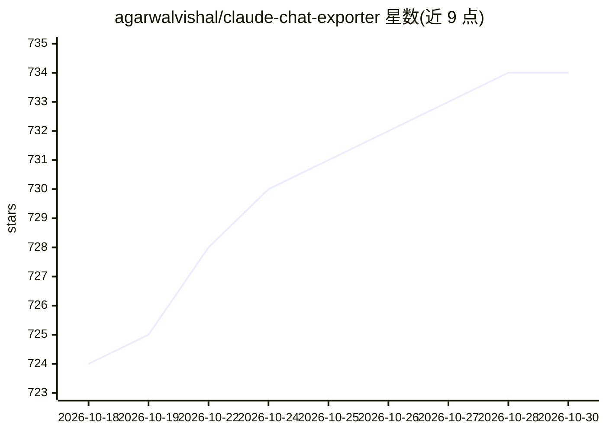

# agarwalvishal/claude-chat-exporter

⭐ 734 · JavaScript · MIT · 推送 2026-10-23 · [GitHub](https://github.com/agarwalvishal/claude-chat-exporter) · [官网](https://agarwalvishal.github.io/claude-chat-exporter/) · 个人维护

**浏览器端一键导出 Claude.ai 对话为 Markdown 的书签工具**

以 bookmarklet 或控制台脚本形式在浏览器内运行的导出工具：调用 Claude.ai 的内部 API，读取当前会话全部消息，按当前分支重建顺序，输出带 YAML frontmatter、每轮一个一级标题的 Markdown 文件，包含 artifacts、生成文件、图表与附件。产物可直接放入 Obsidian 或 RAG 管道。无自有服务器、无追踪，唯一网络请求指向 Claude 自身后端。依赖 Claude 会话 cookie，且 API 结构变更需维护跟进。

## 筛选速览

| 维度 | 判定 | 备注 |
|---|---|---|
| AI 角色 | `ai-ecosystem` | LLM/agent 周边工具 |
| 许可风险 | `permissive` | MIT |
| 部署形态 | `None` |  |
| 模型依赖 | locked-api |  |
| 硬件要求 | — | 无带数字的原话,不猜 |
| 安装摩擦 | `low` | 无编译、无系统依赖或容器化 |
| 成熟度 | — | 结构信号不足 |

## 能力要点

- 读取 Claude API 源 Markdown 导出，覆盖表格/公式/artifacts/附件
- YAML frontmatter + 每轮一级标题，适配 Obsidian 与 RAG 分块
- bookmarklet 一键安装，完全浏览器端运行，无自有服务器
- 每条消息附时间戳，导出含中断/截断标记

## 适用场景

- 把 Claude.ai 对话备份为干净 Markdown 归档
- 将对话导入 Obsidian 笔记库管理
- 把导出文件喂给 RAG 管道作为知识库素材

## 场景标签

 · 领域:AI 对话数据导出/知识管理

## 证据(README 行号)

> L3: A **privacy-first** tool that exports your Claude.ai conversations to clean Markdown. It runs entirely in your brows
> L43: 1. **Fetch** - Calls Claude's internal API for the current conversation (`/api/organizations/{orgId}/chat_conversat
> L5: Everything comes through — tables, math and code at full fidelity, plus artifacts, created files, charts and attachm

## 星数曲线

2026-10-18 724 → 2026-10-30 734（+10）

---
*卡片 v1 · prompt 1.4 · 生成 2026-10-21 · 置信度 high · 依据 README sha `5f808645027a` · [字段定义](../../DATASET.md)*
