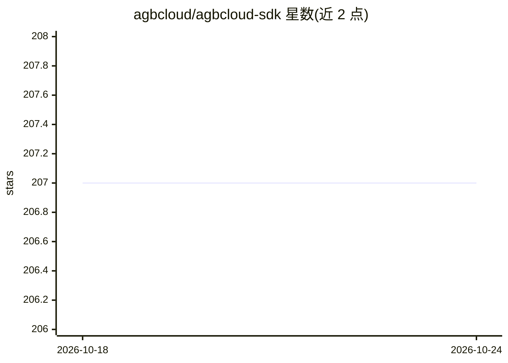

# agbcloud/agbcloud-sdk

⭐ 207 · Python · Apache-2.0 · 推送 2026-04-07 · [GitHub](https://github.com/agbcloud/agbcloud-sdk) · [官网](https://agb.cloud) · 组织维护 · 中文 README

**面向开发者的 AI 沙箱云服务 SDK：会话、代码执行与浏览器自动化**

AGB Cloud 的客户端 SDK，提供 Python 与 TypeScript 库，用于接入 AGB 云服务：创建和管理云会话、文件系统操作、命令与代码执行、带自然语言操作的浏览器自动化、持久上下文管理，以及 Computer Use（Linux 桌面控制）、Browser Use、CodeSpace 三类场景能力。另提供预构建 Moltbot（原 Clawdbot）云桌面快速部署示例，可在云桌面浏览器内打开控制台。使用需 API key，依赖云端服务运行。

## 筛选速览

| 维度 | 判定 | 备注 |
|---|---|---|
| AI 角色 | `ai-ecosystem` | LLM/agent 周边工具 |
| 许可风险 | `permissive` | Apache-2.0 |
| 部署形态 | `library` | 以包/库形式分发 |
| 模型依赖 | — | README 未给出锁定关系 |
| 硬件要求 | — | 无带数字的原话,不猜 |
| 安装摩擦 | `low` | 无编译、无系统依赖或容器化 |
| 成熟度 | — | 结构信号不足 |

## 能力要点

- Python 与 TypeScript 双语言 SDK
- 云会话内的文件系统、命令执行与代码执行模块
- AI 驱动的自然语言浏览器自动化
- 预构建 Moltbot 云桌面快速部署示例

## 适用场景

- 在云端沙箱中运行不可信或隔离的代码
- 用自然语言指令自动化网页操作与抓取
- 为 AI agent 提供可远程控制的云桌面环境

## 场景标签

`浏览器自动化` `GUI 自动化` · 领域:效率与自动化

## 证据(README 行号)

> L17: AGB Cloud SDK provides client libraries for interacting with the AGB cloud service.
> L22: - Work with file system, command execution, and code execution modules

## 星数曲线

2026-10-18 207 → 2026-10-24 207（+0）

---
*卡片 v1 · prompt 1.4 · 生成 2026-10-22 · 置信度 high · 依据 README sha `74fc42cbcc95` · [字段定义](../../DATASET.md)*
