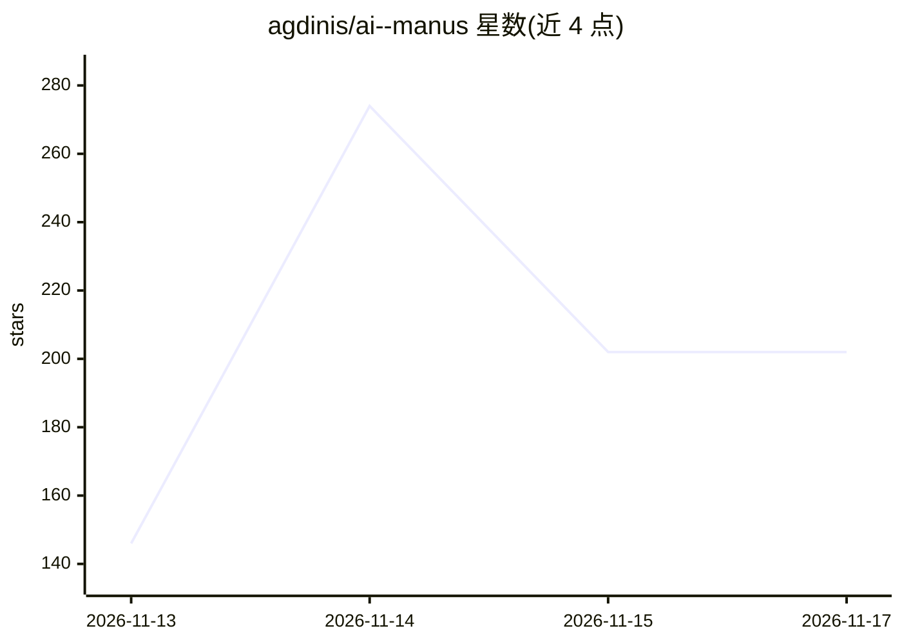

# agdinis/ai--manus

⭐ 202 · Apache-2.0 · 推送 2026-11-13 · [GitHub](https://github.com/agdinis/ai--manus) · 个人维护

**自主 AI Agent：代替用户执行代码与控制浏览器完成任务**

README 描述 Manus 为自主 AI agent，可在沙箱中运行代码、控制浏览器完成多步骤任务，定位为面向个人、学习和轻量办公的个人助手，非企业平台。功能点包括自动执行脚本、网页导航与表单填写、后台任务处理、跨会话记忆工作流。README 给出硬件兼容表（最低 4GB RAM、双核 CPU）与使用步骤说明，但未提供任何具体安装命令、代码仓库入口或技术实现细节，安装方式为下载（附推广码 PROMO2026）。

## 筛选速览

| 维度 | 判定 | 备注 |
|---|---|---|
| AI 角色 | `ai-native` | 本体是模型或模型工具 |
| 许可风险 | `permissive` | Apache-2.0 |
| 部署形态 | `None` |  |
| 模型依赖 | — | README 未给出锁定关系 |
| 硬件要求 | — | 无带数字的原话,不猜 |
| 安装摩擦 | `low` | 无编译、无系统依赖或容器化 |
| 成熟度 | — | 结构信号不足 |

## 能力要点

- 自主执行代码与控制浏览器完成多步骤任务
- 任务覆盖研究整理、表单填写、文件检查与网页信息采集
- 跨会话记住工作流模式并可重复应用
- README 提供硬件兼容性要求表（最低 4GB RAM/双核 CPU）

## 适用场景

- 让 agent 代为执行重复性的脚本与浏览器操作
- 学习与研究中收集资料、整理笔记、跑小脚本
- 轻量办公中从多个网页汇总信息并准备摘要

## 场景标签

`浏览器自动化` `AI 助手` `网页抓取` · 领域:效率与自动化

## 证据(README 行号)

> L18: Manus is an autonomous AI agent designed to run code and control a browser on your behalf. Instead of acting like a
> L22: Manus is not a heavy studio suite or a complex enterprise platform. It is a focused helper built for home, study, a

## 星数曲线

2026-11-13 146 → 2026-11-17 202（+56）

---
*卡片 v1 · prompt 1.4 · 生成 2026-11-17 · 置信度 mid · 依据 README sha `66ba5de9af15` · [字段定义](../../DATASET.md)*
