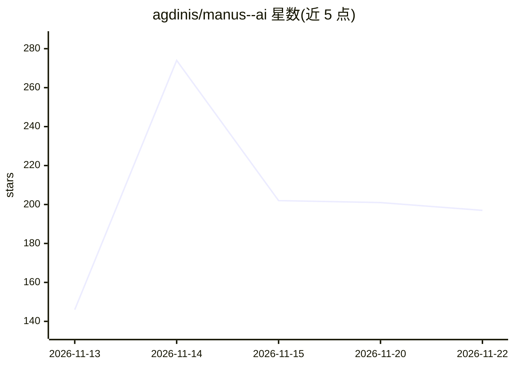

# agdinis/manus--ai

⭐ 197 · Apache-2.0 · 推送 2026-11-13 · [GitHub](https://github.com/agdinis/manus--ai) · 个人维护

**面向个人用户的自主 AI Agent：代跑代码与操控浏览器**

README 以营销文案形式描述名为 Manus 的自主 AI Agent：宣称可在用户授权下编写并执行脚本、控制浏览器（导航网页、填表、收集信息），执行多步任务，定位为家庭、学习与轻办公场景的个人助理，非企业平台。文中给出兼容性表（最低双核 CPU、4 GB 内存）与六步上手流程，但未提供任何安装命令、代码仓库结构、模型接入方式或技术实现细节，可验证的技术事实有限。

## 筛选速览

| 维度 | 判定 | 备注 |
|---|---|---|
| AI 角色 | `ai-native` | 本体是模型或模型工具 |
| 许可风险 | `permissive` | Apache-2.0 |
| 部署形态 | `None` |  |
| 模型依赖 | — | README 未给出锁定关系 |
| 硬件要求 | — | 无带数字的原话,不猜 |
| 安装摩擦 | `low` | 无编译、无系统依赖或容器化 |
| 成熟度 | — | 结构信号不足 |

## 能力要点

- 宣称支持自主执行代码与浏览器控制的多步任务
- 定位为家庭/学习/轻办公场景的个人助理
- 给出最低 4 GB 内存、双核 CPU 的兼容性表

## 适用场景

- 让代理代为完成网页查资料、填表等重复操作
- 学习与研究中自动运行小脚本、整理笔记
- 远程排查时快速检查系统页面

## 场景标签

`AI 助手` `浏览器自动化` `编码 Agent` · 领域:效率与自动化

## 证据(README 行号)

> L18: Manus is an autonomous AI agent designed to run code and control a browser on your behalf. Instead of acting like a
> L22: Manus is not a heavy studio suite or a complex enterprise platform. It is a focused helper built for home, study, a

## 星数曲线

2026-11-13 146 → 2026-11-22 197（+51）

---
*卡片 v1 · prompt 1.4 · 生成 2026-11-17 · 置信度 low · 依据 README sha `66ba5de9af15` · [字段定义](../../DATASET.md)*
