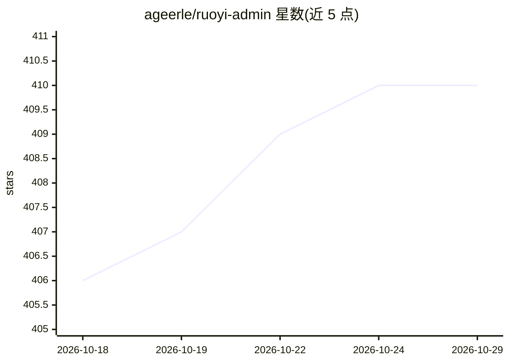

# ageerle/ruoyi-admin

⭐ 410 · Vue · MIT · 推送 2026-09-23 · [GitHub](https://github.com/ageerle/ruoyi-admin) · [官网](https://admin.ruoyiai.chat/chat) · 个人维护 · 中文 README

**RuoYi-AI 平台的管理后台：系统/模型/知识库/工作流管理**

基于 Vue 3 + Vben Admin + element-plus-x + Vite 构建的 RuoYi-AI 企业级 AI 助手平台管理面板，负责系统管理、模型配置、知识库管理与工作流编排，与后端服务（端口 6039）、用户前端（5137）及 MySQL、Redis、Weaviate 向量库、MinIO 对象存储等依赖协同运行。提供 docker-compose 一键启动全部服务与源码分开部署两种 Docker 方式，也支持 pnpm 本地开发，MIT 许可。

## 筛选速览

| 维度 | 判定 | 备注 |
|---|---|---|
| AI 角色 | `ai-ecosystem` | LLM/agent 周边工具 |
| 许可风险 | `permissive` | MIT |
| 部署形态 | `library` | 以包/库形式分发 |
| 模型依赖 | — | README 未给出锁定关系 |
| 硬件要求 | — | 无带数字的原话,不猜 |
| 安装摩擦 | `low` | 无编译、无系统依赖或容器化 |
| 成熟度 | — | 结构信号不足 |

## 能力要点

- 覆盖模型配置、知识库管理与工作流编排的管理界面
- docker-compose-all 一键启动后端/管理端/用户端及全部依赖
- 源码分开部署方式便于自定义修改
- 配套 Weaviate 向量库与 MinIO 对象存储的服务编排

## 适用场景

- 部署并管理 RuoYi-AI 平台的模型与知识库配置
- 通过管理端编排 AI 工作流与用户端功能
- 开发者在本地用 pnpm 二次开发管理面板

## 场景标签

`工作流自动化` · 领域:效率与自动化

## 证据(README 行号)

> L7: *The RuoYi-AI admin panel for system management, model configuration, knowledge-base management, and workflow orches
> L5: ### Enterprise-Grade AI Assistant Platform - Admin Panel

## 星数曲线

2026-10-18 406 → 2026-10-29 410（+4）

---
*卡片 v1 · prompt 1.4 · 生成 2026-10-21 · 置信度 mid · 依据 README sha `885a55eab056` · [字段定义](../../DATASET.md)*
