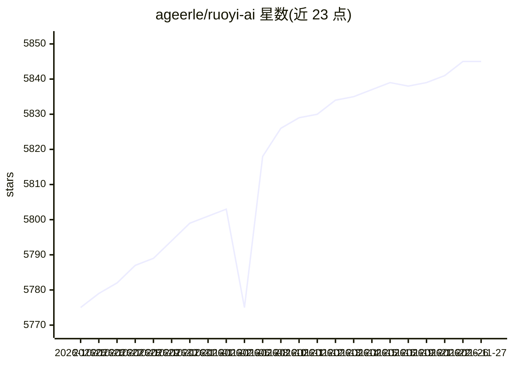

# ageerle/ruoyi-ai

⭐ 5,845 · Java · MIT · 推送 2026-11-19 · [GitHub](https://github.com/ageerle/ruoyi-ai) · [官网](https://doc.ruoyiai.chat) · 组织维护 · 中文 README

**企业级全栈 AI 助手平台：多模型、知识库 RAG 与多 Agent 编排**

基于 Spring Boot 3.5.8 与 Langchain4j 的全栈 AI 助手平台，包含后端、管理面板、用户前端、小程序等多个仓库模块。功能覆盖多模型接入（DeepSeek/智谱/百炼/OpenAI）、本地 RAG 与向量库文档解析、MCP 协议工具集成、可视化拖拽工作流编排（SSE 流式执行），以及基于 Supervisor 模式的多 Agent 协同。提供 Docker 一键部署与源码分步部署两种方式，MIT 许可。

## 筛选速览

| 维度 | 判定 | 备注 |
|---|---|---|
| AI 角色 | `ai-ecosystem` | LLM/agent 周边工具 |
| 许可风险 | `permissive` | MIT |
| 部署形态 | `self-host` | docker 或自建部署 |
| 模型依赖 | — | README 未给出锁定关系 |
| 硬件要求 | — | 无带数字的原话,不猜 |
| 安装摩擦 | `low` | 无编译、无系统依赖或容器化 |
| 成熟度 | — | 结构信号不足 |

## 能力要点

- 多模型接入与 Coze/DIFY/FastGPT/RAGFlow 平台集成
- 本地 RAG：Milvus/Weaviate/Qdrant 向量库 + PDF/Word/Excel 文档解析
- 可视化工作流设计器，支持模型调用、邮件发送、人工审核等节点
- 基于 Langchain4j 的多 Agent 框架与 Supervisor 模式编排

## 适用场景

- 企业内部搭建自有 AI 助手与客服平台
- 将文档接入向量库构建知识库问答
- 用可视化工作流编排模型调用与审批流程
- 组合多个 Agent 与工具完成复杂任务

## 场景标签

`AI 助手` `RAG` `多智能体` `工作流自动化` · 领域:Agent 开发

## 证据(README 行号)

> L13: *An out-of-the-box full-stack AI platform supporting multi-agent collaboration, Supervisor mode orchestration, and 
> L34: |**Multi-Agent**|Agent framework based on Langchain4j, Supervisor mode orchestration, supports multiple decision mo
> L55: - **Backend**: Spring Boot 3.5.8 + Langchain4j

## 星数曲线

2026-10-25 5,775 → 2026-11-27 5,845（+70）

---
*卡片 v1 · prompt 1.4 · 生成 2026-11-22 · 置信度 high · 依据 README sha `998314a76d39` · [字段定义](../../DATASET.md)*
