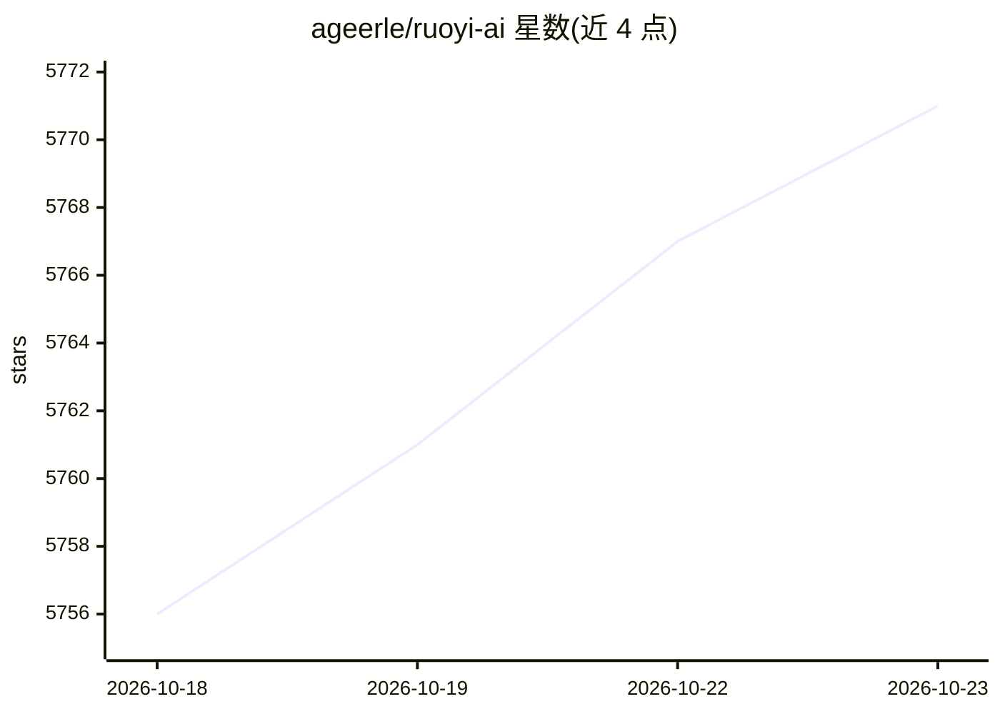

# ageerle/ruoyi-ai

⭐ 5,771 · Java · MIT · 推送 2026-10-21 · [GitHub](https://github.com/ageerle/ruoyi-ai) · [官网](https://doc.ruoyiai.chat) · 组织维护 · 中文 README

**企业级全栈 AI 助手平台：多模型、RAG 知识库与可视化工作流**

基于 Spring Boot 3.5.8 + Langchain4j 与 Vue 3 的开箱即用 AI 平台，面向企业部署。功能覆盖多模型接入（DeepSeek/智谱/OpenAI 等）、本地 RAG 与向量数据库（Milvus/Weaviate/Qdrant）、MCP 工具集成、可视化工作流设计器与多 Agent Supervisor 编排。提供 Docker 一键部署与源码分步构建两种方式，服务含后端、管理端、用户前端及 MySQL/Redis/Weaviate/MinIO 依赖；另有商业版入口。MIT 许可，由 RuoYi AI 开源社区维护。

## 筛选速览

| 维度 | 判定 | 备注 |
|---|---|---|
| AI 角色 | `ai-native` | 本体是模型或模型工具 |
| 许可风险 | `permissive` | MIT |
| 部署形态 | `self-host` | docker 或自建部署 |
| 模型依赖 | locked-api |  |
| 硬件要求 | — | 无带数字的原话,不猜 |
| 安装摩擦 | `low` | 无编译、无系统依赖或容器化 |
| 成熟度 | — | 结构信号不足 |

## 能力要点

- 多模型接入与多模态理解，集成 Coze/DIFY/FastGPT/RAGFlow 平台
- 本地 RAG + Milvus/Weaviate/Qdrant 向量库与文档解析
- 基于 Langchain4j 的多 Agent 框架与 Supervisor 编排
- 可视化拖拽工作流设计器，SSE 流式执行

## 适用场景

- 企业内部搭建带知识库问答的 AI 助手平台
- 通过可视化编排搭建多 Agent 协作流程
- 对接多家模型服务并统一管理 API Key

## 场景标签

`Agent 框架` `多智能体` `工作流自动化` `AI 助手` · 领域:Agent 开发

## 证据(README 行号)

> L13: *An out-of-the-box full-stack AI platform supporting multi-agent collaboration, Supervisor mode orchestration, and 
> L34: |**Multi-Agent**|Agent framework based on Langchain4j, Supervisor mode orchestration, supports multiple decision mo

## 星数曲线

2026-10-18 5,756 → 2026-10-23 5,771（+15）

---
*卡片 v1 · prompt 1.4 · 生成 2026-10-20 · 置信度 high · 依据 README sha `5890adf1b609` · [字段定义](../../DATASET.md)*
