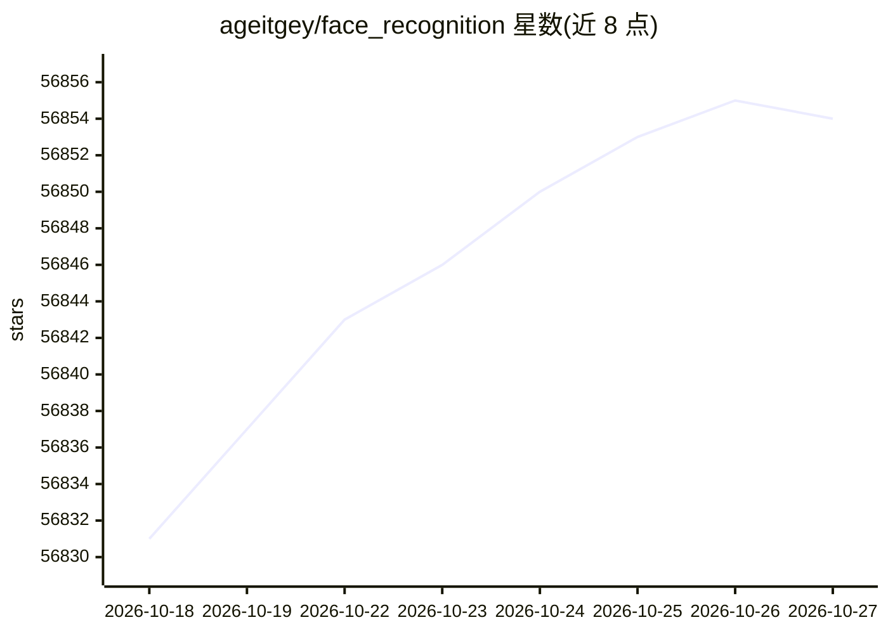

# ageitgey/face_recognition

⭐ 56,854 · Python · MIT · 推送 2026-06-25 · [GitHub](https://github.com/ageitgey/face_recognition) · 个人维护

**给 Python/命令行用户提供的简单人脸识别库**

基于 dlib 深度学习模型构建的 Python 库与命令行工具：支持从图片中定位人脸、提取眼睛/鼻子/嘴等面部特征点、生成人脸编码并比对识别人物，提供 face_recognition 与 face_detection 两个 CLI 命令，支持 --tolerance 阈值与 --cpus 多核并行。模型在 LFW 基准上自报准确率 99.38%。要求 Python 3.3+/2.7 与 macOS/Linux（Windows 非官方支持），依赖预装 dlib 与 cmake，亦可经 Docker 运行。

## 筛选速览

| 维度 | 判定 | 备注 |
|---|---|---|
| AI 角色 | `ai-ecosystem` | LLM/agent 周边工具 |
| 许可风险 | `permissive` | MIT |
| 部署形态 | `library` | 以包/库形式分发 |
| 模型依赖 | — | README 未给出锁定关系 |
| 硬件要求 | — | 无带数字的原话,不猜 |
| 安装摩擦 | `medium` | 含编译或系统依赖之一 |
| 成熟度 | — | 结构信号不足 |

## 动量与使用信号

- 维护:`maintenance` — 距上次 push 114.9 天,年发版 0,50 位贡献者
- 涨星:近 1 天 **+5**(自 20261016 起算)
- 安装:pypi 包 `face_recognition` 月下载 92,902
- 平台:WINDOWS / MACOS / LINUX · 协议:—

## 能力要点

- 提供 Python API 与 face_recognition/face_detection 命令行工具
- 人脸定位、特征点提取、编码与比对三类功能
- 支持 --cpus 多核并行与 --tolerance 匹配阈值调节
- 提供 CNN 模型选项（model="cnn"）的检测示例

## 适用场景

- 从一批照片中识别已知人物并输出 CSV 结果
- 提取图片中人脸的关键点轮廓（如数字化妆应用）
- 配合其他 Python 库实现实时人脸识别

## 场景标签

`人脸识别` · 领域:感知与多模态

## 证据(README 行号)

> L8: Built using dlib's state-of-the-art face recognition
> L63: ## Installation
> L82: Finally, install this module from pypi using `pip3` (or `pip2` for Python 2):

## 星数曲线

2026-10-18 56,831 → 2026-10-27 56,854（+23）

---
*卡片 v1 · prompt 1.4 · 生成 2026-10-18 · 置信度 high · 依据 README sha `d90bf9bf30ca` · [字段定义](../../DATASET.md)*
