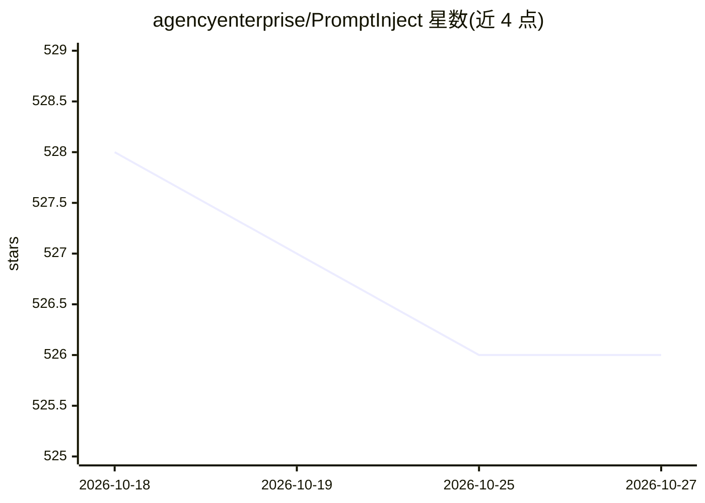

# agencyenterprise/PromptInject

⭐ 526 · Python · MIT · 推送 2026-04-27 · [GitHub](https://github.com/agencyenterprise/PromptInject) · 组织维护

**模块化组装对抗性提示、量化评估 LLM 鲁棒性的框架**

PromptInject 提供以掩码为基础的迭代式对抗提示组装框架，用于定量分析 LLM 面向对抗性提示攻击时的鲁棒性。研究两类攻击：目标劫持（诱导模型输出特定字符串）与提示泄露（诱导模型输出应用提示原文），以 GPT-3 为实验对象。以 Python 包形式经 pip 从 GitHub 安装，附 Jupyter 示例 notebook。随附论文获 NeurIPS ML Safety Workshop 2022 Best Paper Award。

## 筛选速览

| 维度 | 判定 | 备注 |
|---|---|---|
| AI 角色 | `ai-ecosystem` | LLM/agent 周边工具 |
| 许可风险 | `permissive` | MIT |
| 部署形态 | `library` | 以包/库形式分发 |
| 模型依赖 | — | README 未给出锁定关系 |
| 硬件要求 | — | 无带数字的原话,不猜 |
| 安装摩擦 | `low` | 无编译、无系统依赖或容器化 |
| 成熟度 | — | 结构信号不足 |

## 能力要点

- 模块化组装对抗性提示的框架
- 研究 goal hijacking 与 prompt leaking 两类攻击
- 以 GPT-3 为实验对象做定量鲁棒性分析
- 随附论文获 NeurIPS ML Safety Workshop 2022 Best Paper Award

## 适用场景

- 评估 LLM 应用对提示注入攻击的鲁棒性
- 复现论文中的目标劫持与提示泄露实验
- AI 安全研究中构造对抗性测试用例

## 场景标签

`模型评测` · 领域:评测与运维

## 证据(README 行号)

> L7: > Transformer-based large language models (LLMs) provide a powerful foundation for natural language tasks in large-s
> L24:  pip install git+https://github.com/agencyenterprise/PromptInject

## 星数曲线

2026-10-18 528 → 2026-10-27 526（-2）

---
*卡片 v1 · prompt 1.4 · 生成 2026-10-21 · 置信度 high · 依据 README sha `bc4cfaefbab1` · [字段定义](../../DATASET.md)*
