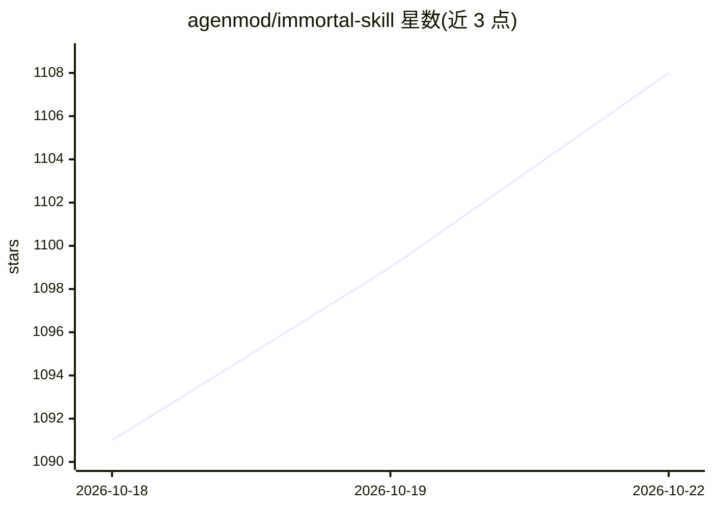

# agenmod/immortal-skill

⭐ 1,111 · Python · MIT · 推送 2026-04-15 · [GitHub](https://github.com/agenmod/immortal-skill) · [官网](https://agenworld.com) · 组织维护 · 中文 README

**开源数字永生框架：从聊天记录蒸馏任何人的数字分身 Skill**

以 SKILL.md 为入口的 Agent Skill 工程：从微信、飞书、iMessage、Telegram 等 12+ 平台的聊天记录、归档与文档中，按四维（程序性知识、互动风格、记忆经历、人格价值观）结构化蒸馏个人数字分身，每条结果标注 verbatim/artifact/impression 三级证据。提供 7 种关系角色模板与对应伦理底线（授权/知情/脱敏），输出为 Agent Skills 标准文件夹，兼容 OpenClaw。配套生态含防蒸馏（三层防护）与蒸馏授权协议等独立仓库。使用需 Python 3.9+，通过复制进 skills 目录安装，依赖 AI Agent 执行蒸馏。

## 筛选速览

| 维度 | 判定 | 备注 |
|---|---|---|
| AI 角色 | `ai-native` | 本体是模型或模型工具 |
| 许可风险 | `permissive` | MIT |
| 部署形态 | `None` |  |
| 模型依赖 | — | README 未给出锁定关系 |
| 硬件要求 | — | 无带数字的原话,不猜 |
| 安装摩擦 | `medium` | 含编译或系统依赖之一 |
| 成熟度 | — | 结构信号不足 |

## 能力要点

- 四维蒸馏引擎，输出兼容 Agent Skills 标准 / OpenClaw
- 12+ 平台数据接入：API 拉取、本地数据库读取、官方归档解析
- 7 种关系角色模板，各带授权/知情同意/脱敏要求
- 证据三级分级（verbatim > artifact > impression）与矛盾保留机制

## 适用场景

- 把退休导师或离职同事的工作方法蒸馏成 AI 可加载的 Skill
- 保存亲人的说话方式与家族记忆为数字分身
- 蒸馏公众人物公开言论中的认知框架作为参谋

## 场景标签

 · 领域:AI Agent 技能/数字分身

## 证据(README 行号)

> L45: |**① 数字永生**|全网首个开源数字永生框架：四维蒸馏引擎|你在这里|`SKILL.md`|
> L233: 一个人 = 一个文件夹 = 一个可以直接用的 AI Skill：
> L242: 丢进 OpenClaw 的 skills 目录，AI 就能用奶奶的语气跟你说话了。

## 星数曲线

2026-10-18 1,091 → 2026-10-22 1,108（+17）

---
*卡片 v1 · prompt 1.4 · 生成 2026-10-21 · 置信度 mid · 依据 README sha `89aa6581e399` · [字段定义](../../DATASET.md)*
