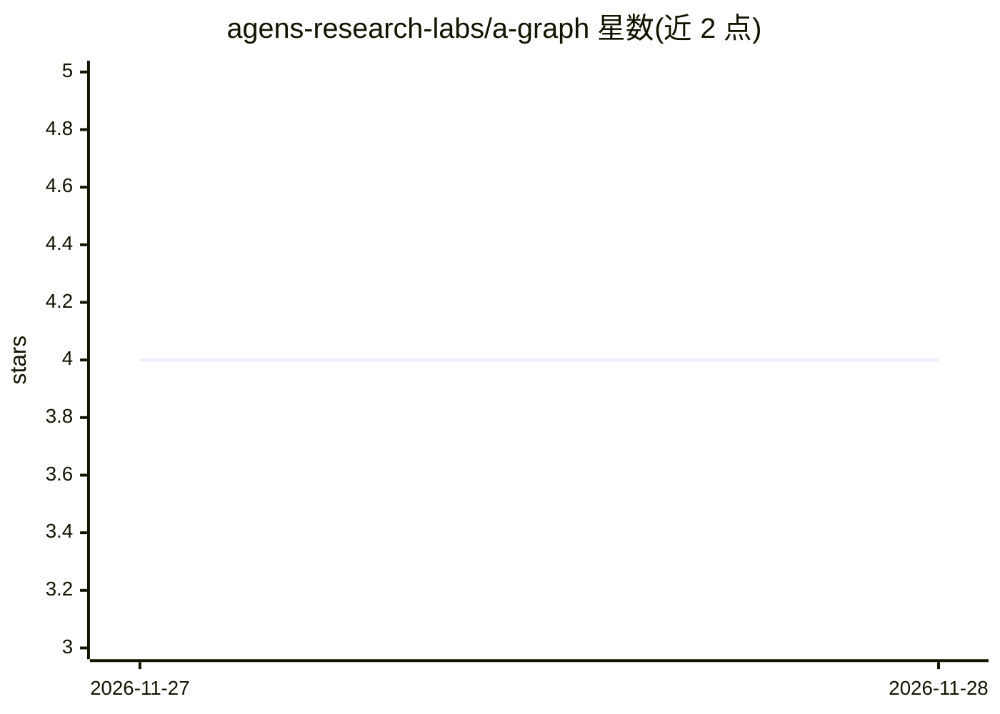

# agens-research-labs/a-graph

⭐ 4 · Rust · MIT · 推送 2026-11-27 · [GitHub](https://github.com/agens-research-labs/a-graph) · 组织维护

**用 YAML 声明式定义并运行 agent 图的 Rust 引擎**

一个声明式 AI agent 框架：以单个 YAML 文件描述 agent 图中的模型、提示词、节点顺序与连接模式，引擎在首次调用前做整文件校验（键、ID、链接、主机、环境变量），再执行运行。提供命令行程序与小型 HTTP 服务两种形态，Rust 编写。内置九家模型提供方接入、结构化输出、批量任务、MCP 服务器与工具调用、JSON 日志与 OpenTelemetry 追踪，密钥仅以环境变量名出现在文件中。

## 筛选速览

| 维度 | 判定 | 备注 |
|---|---|---|
| AI 角色 | `ai-ecosystem` | LLM/agent 周边工具 |
| 许可风险 | `permissive` | MIT |
| 部署形态 | `self-host` | docker 或自建部署 |
| 模型依赖 | local-ok | 支持本地模型 |
| 硬件要求 | — | 无带数字的原话,不猜 |
| 安装摩擦 | `low` | 无编译、无系统依赖或容器化 |
| 成熟度 | — | 结构信号不足 |

## 能力要点

- YAML 声明式定义 agent 图，运行前整文件静态校验（--check）
- 一次编写接入九家提供方（Anthropic/OpenAI/Gemini/Mistral/Bedrock/Vertex AI/Foundry/Ollama 及 Ollama 兼容服务）
- 节点级事件追踪：JSON 日志 + OpenTelemetry trace + 实时显示
- 支持 pipelines、并发/顺序分支、react 控制器、judge 校验节点等图模式

## 适用场景

- 用 YAML 编排多 agent 工作流而不写编排代码
- 本地用 Ollama 无 key 快速试跑 agent 图示例
- 以 HTTP 服务形式接收外部提交的图定义并安全执行
- 通过 OpenTelemetry/Jaeger 观测每次 agent 运行的调用与失败原因

## 场景标签

`Agent 框架` · 领域:Agent 开发

## 证据(README 行号)

> L3: A-Graph is a declarative framework for AI agents: the agents are described in a YAML file, and an engine checks the
> L25: `a-graph` runs a **graph of agents written in a YAML file**. The file holds the problem of the agents: the models,
> L51: It is a program for the command line and a small HTTP service, written in Rust. It was designed with a

## 星数曲线

2026-11-27 4 → 2026-11-28 4（+0）

---
*卡片 v1 · prompt 1.4 · 生成 2026-11-27 · 置信度 high · 依据 README sha `9de22c74a909` · [字段定义](../../DATASET.md)*
