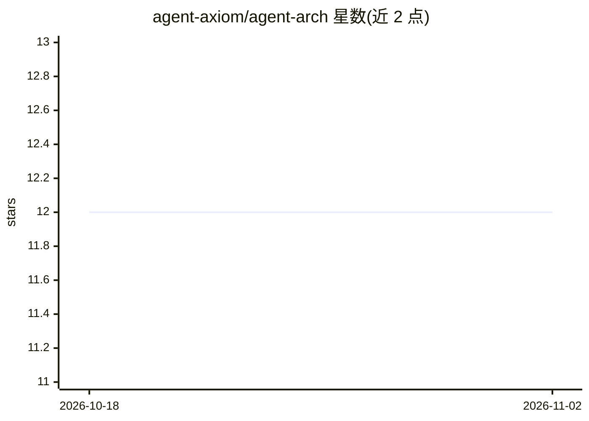

# agent-axiom/agent-arch

⭐ 12 · Python · NOASSERTION · 推送 2026-10-08 · [GitHub](https://github.com/agent-axiom/agent-arch) · [官网](https://agent-axiom.github.io/agent-arch/) · 组织维护 · 中文 README

**面向生产环境的 AI agent 架构知识库：书籍+文档站+可运行参考实现**

多语言书籍与 MkDocs 文档站，主题为安全、可治理、可上线的 AI agent 架构：信任边界、策略与审批、记忆纪律、可观测性与评测、发布与生命周期管理。附带可运行的参考运行时 agent_runtime_ref（策略层、能力目录、遥测、回滚检查等 YAML 驱动骨架）与可安装的 safe-agent-architecture agent 技能。用 uv 管理环境，提供三个贯穿全栈的案例场景。许可证为 CC BY-SA 4.0。

## 筛选速览

| 维度 | 判定 | 备注 |
|---|---|---|
| AI 角色 | `ai-knowledge` | 知识聚合/清单类 |
| 许可风险 | `none` | NOASSERTION |
| 部署形态 | `library` | 以包/库形式分发 |
| 模型依赖 | — | README 未给出锁定关系 |
| 硬件要求 | — | 无带数字的原话,不猜 |
| 安装摩擦 | `low` | 无编译、无系统依赖或容器化 |
| 成熟度 | — | 结构信号不足 |

## 能力要点

- 多语言书籍 + MkDocs 文档站 + GitHub Pages 发布
- 可运行参考运行时 agent_runtime_ref（策略/审批/遥测/回滚/生命周期）
- 可通过 npx skills add 安装的 safe-agent-architecture agent 技能
- 三个贯穿书籍与参考实现的案例（支持分诊/知识助手/事件协调）

## 适用场景

- 构建生产级 agent 系统前学习安全与治理架构
- 参考 trace/eval/memory 等安全 schema 设计自身系统
- 在本地运行参考骨架观察策略、审批与遥测的实际运作

## 场景标签

`教程课程` · 领域:学习与行业

## 证据(README 行号)

> L10: A practical book and documentation site about secure, governable, production-grade AI agent architecture.
> L30: - a multilingual book on secure AI agent architecture

## 星数曲线

2026-10-18 12 → 2026-11-02 12（+0）

---
*卡片 v1 · prompt 1.4 · 生成 2026-11-01 · 置信度 high · 依据 README sha `0ca8eb41b96e` · [字段定义](../../DATASET.md)*
