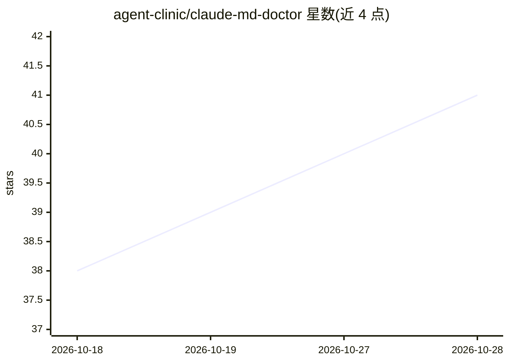

# agent-clinic/claude-md-doctor

⭐ 41 · Python · MIT · 推送 2026-08-30 · [GitHub](https://github.com/agent-clinic/claude-md-doctor) · [官网](https://skills.sh/agent-clinic/claude-md-doctor) · 组织维护

**给 Claude Code 用户的 CLAUDE.md 做体检审计的技能插件**

作为 Claude Code 插件/skill 运行的本地审计工具：读取 CLAUDE.md/AGENTS.md 及其 imports 与 rules，检查体积与 token 成本、死引用路径、可计数声明是否与仓库一致，并利用本地会话转录（~/.claude/projects）回测每条规则的历史遵从率，按违规划分原因（defiance/dilution/absence）给出处置建议与 hook 提案。无 CLAUDE.md 时可从会话历史挖掘规则生成 PROPOSED-CLAUDE.md 草稿，每行附证据注释。输出 HTML/JSON 报告，仅用 Python 3.9+ 标准库，全程本地运行无遥测。

## 筛选速览

| 维度 | 判定 | 备注 |
|---|---|---|
| AI 角色 | `ai-ecosystem` | LLM/agent 周边工具 |
| 许可风险 | `permissive` | MIT |
| 部署形态 | `library` | 以包/库形式分发 |
| 模型依赖 | — | README 未给出锁定关系 |
| 硬件要求 | — | 无带数字的原话,不猜 |
| 安装摩擦 | `low` | 无编译、无系统依赖或容器化 |
| 成熟度 | — | 结构信号不足 |

## 能力要点

- 将 CLAUDE.md 分解为规则并对本地会话历史逐条回测遵从率
- 检查死引用路径、失效命令、可计数声明与仓库实际是否一致
- 违反按原因分诊（defiance/dilution/absence），生成 review-then-arm 的 hook 提案
- 无 CLAUDE.md 时从会话转录挖掘重复纠正等信号起草 PROPOSED-CLAUDE.md

## 适用场景

- 想知道我写的 CLAUDE.md 规则哪些被遵守、哪些被忽略
- 清理 CLAUDE.md 中的死引用和过期的数字声明
- 从历史会话中提取值得固化的规则来生成记忆文件草稿

## 场景标签

`提示工程` · 领域:Agent 开发

## 证据(README 行号)

> L5:  Give your CLAUDE.md — or AGENTS.md — a checkup.
> L74: Your own Claude Code session transcripts (`~/.claude/projects/…`) already
> L76: The doctor decomposes the file into rules and replays them against that

## 星数曲线

2026-10-18 38 → 2026-10-28 41（+3）

---
*卡片 v1 · prompt 1.4 · 生成 2026-10-25 · 置信度 high · 依据 README sha `653b307a8f76` · [字段定义](../../DATASET.md)*
