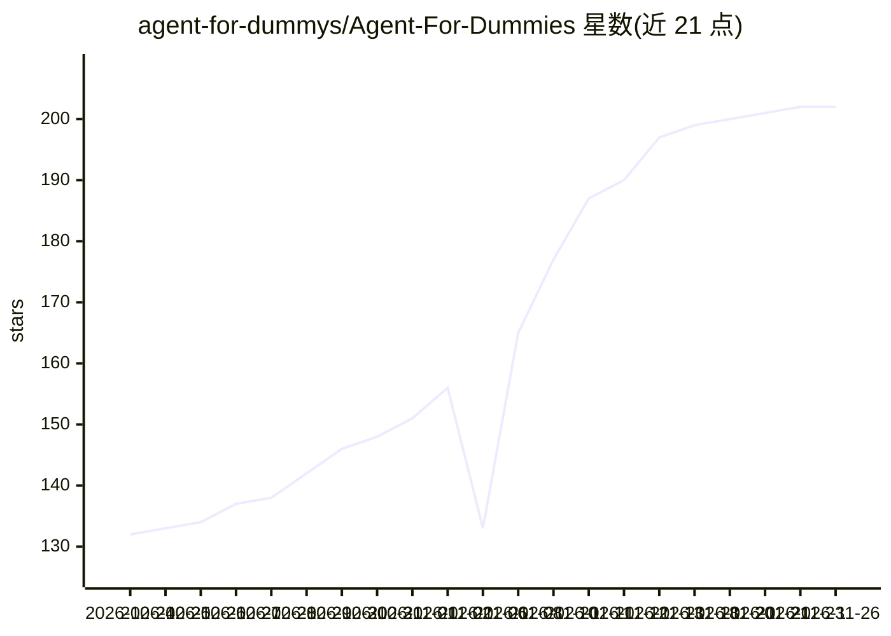

# agent-for-dummys/Agent-For-Dummies

⭐ 202 · Python · NOASSERTION · 推送 2026-11-18 · [GitHub](https://github.com/agent-for-dummys/Agent-For-Dummies) · 个人维护 · 中文 README

**面向初学者的 Agent/RAG 学习笔记与编程入门平台**

由个人维护的 Agent/RAG/大模型学习资料合集，包含在线可读的中文学习笔记（Transformer、NLP、Hermes/Harness、全栈基础、Linux/Git/Docker 开发基础等，持续更新）和一个 PyTorch 与 Agent 从 0 到 1 的入门编程平台：克隆源码后在本地启动网页，按路线图逐模块练习基础函数代码。笔记提供 ADHD 阅读友好排版，原创文字以 CC BY 4.0 发布，接受 Issue/PR 补充纠错。

## 筛选速览

| 维度 | 判定 | 备注 |
|---|---|---|
| AI 角色 | `ai-knowledge` | 知识聚合/清单类 |
| 许可风险 | `none` | NOASSERTION |
| 部署形态 | `None` |  |
| 模型依赖 | — | README 未给出锁定关系 |
| 硬件要求 | — | 无带数字的原话,不猜 |
| 安装摩擦 | `low` | 无编译、无系统依赖或容器化 |
| 成熟度 | — | 结构信号不足 |

## 能力要点

- Agent/RAG/大模型主题的中文入门学习笔记，提供在线阅读站点
- PyTorch 与 Agent 从 0 到 1 本地编程练习平台（npm run setup/learn 启动）
- ADHD 阅读友好排版功能
- 接受 Issue 与 Pull Request 协作补充

## 适用场景

- 零基础入门 Agent 与 RAG 概念，系统阅读中文学习笔记
- 在本地编程平台逐步练习 PyTorch 与 Agent 基础函数
- 补齐 Linux、Git、Docker 等 Agent 开发前置技能

## 场景标签

`教程课程` · 领域:学习与行业

## 证据(README 行号)

> L1: # 🤖 Agent For Dummies | Agent 基础入门编程平台➕学习笔记
> L21: 这是一个帮助初学者快速学习并上手 PyTorch 和 Agent 的基本函数入门编程平台，旨在帮助所有一下子看不懂整个项目 or 长代码的朋友快速了解并熟悉常用代码。
> L56: 这是agent/RAG/大模型学习 个人学习笔记与Agent入门编程平台，风格比较简洁精炼，图文结合，零基础/adhd友好，正在持续更新中。欢迎star追更！！！

## 星数曲线

2026-10-24 132 → 2026-11-26 202（+70）

---
*卡片 v1 · prompt 1.4 · 生成 2026-11-25 · 置信度 high · 依据 README sha `8c0dae786832` · [字段定义](../../DATASET.md)*
