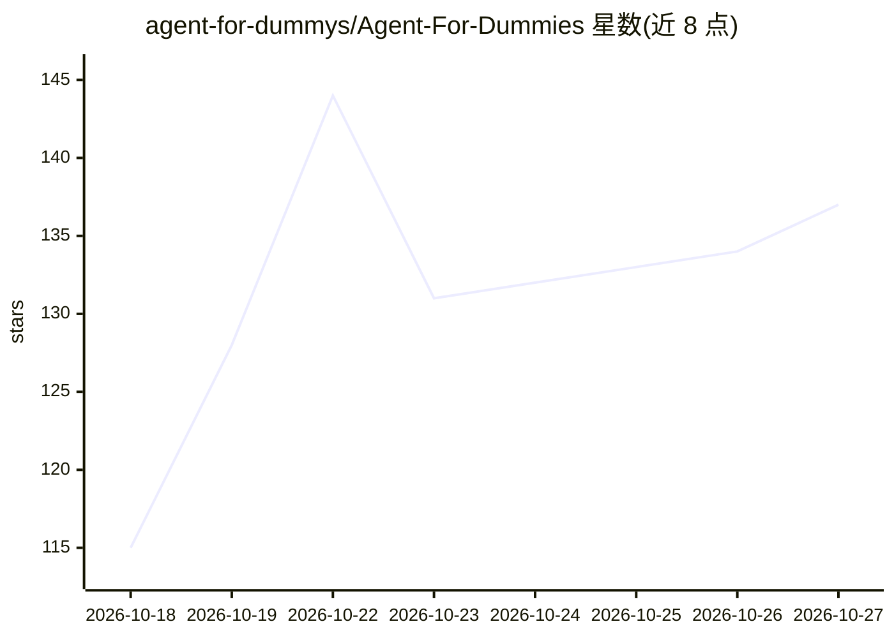

# agent-for-dummys/Agent-For-Dummies

⭐ 137 · Python · NOASSERTION · 推送 2026-10-22 · [GitHub](https://github.com/agent-for-dummys/Agent-For-Dummies) · 个人维护 · 中文 README

**零基础学 Agent/RAG/LLM 的学习笔记与入门编程平台**

个人维护的 Agent、RAG、大模型入门学习仓库，包含在线可读的笔记文档（Hermes/Harness/Transformer/NLP 基础/全栈基础等，持续更新），以及一个 PyTorch 与 Agent 从 0 到 1 的入门编程平台：本地克隆源码后通过 npm run setup 与 npm run learn 启动网页与服务，按学习路线图进入分模块编程练习。笔记标注零基础与 ADHD 阅读友好，原创文字以 CC BY 4.0 发布，欢迎通过 Issue/PR 补充纠错。

## 筛选速览

| 维度 | 判定 | 备注 |
|---|---|---|
| AI 角色 | `ai-knowledge` | 知识聚合/清单类 |
| 许可风险 | `none` | NOASSERTION |
| 部署形态 | `None` |  |
| 模型依赖 | — | README 未给出锁定关系 |
| 硬件要求 | — | 无带数字的原话,不猜 |
| 安装摩擦 | `low` | 无编译、无系统依赖或容器化 |
| 成熟度 | `idea` | |

## 能力要点

- 覆盖 Hermes/Harness/Transformer/NLP 基础等主题的持续更新笔记
- PyTorch 与 Agent 从 0 到 1 的本地编程学习平台（npm run learn 启动）
- 学习路线图总览与分模块编程练习
- ADHD 阅读友好功能与 CC BY 4.0 许可的原创笔记

## 适用场景

- 零基础系统学习 Agent、RAG 与大模型相关基础知识
- 在本地编程平台上分模块练习 PyTorch 与 Agent 常用代码
- 通过 Issue/PR 参与笔记的补充与纠错

## 场景标签

`教程课程` · 领域:学习与行业

## 证据(README 行号)

> L16: 这是一个帮助初学者快速学习并上手 PyTorch 和 Agent 的基本函数入门编程平台，旨在帮助所有一下子看不懂整个项目 or 长代码的朋友快速了解并熟悉常用代码。
> L51: 这是agent/RAG/大模型学习 个人学习笔记与Agent入门编程平台，风格比较简洁精炼，图文结合，零基础/adhd友好，正在持续更新中。欢迎star追更！！！

## 星数曲线

2026-10-18 115 → 2026-10-27 137（+22）

---
*卡片 v1 · prompt 1.4 · 生成 2026-10-22 · 置信度 high · 依据 README sha `2ae232dd040e` · [字段定义](../../DATASET.md)*
