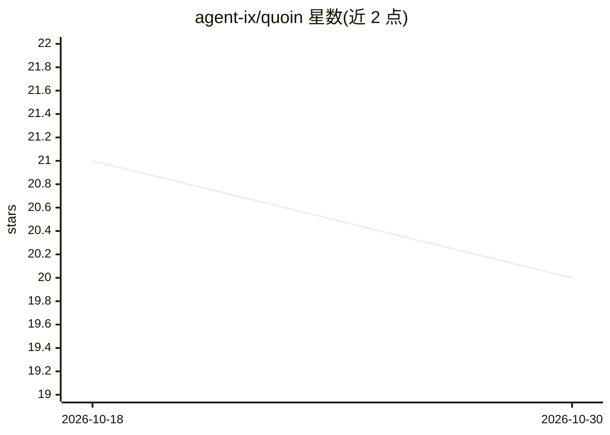

# agent-ix/quoin

⭐ 20 · Rust · AGPL-3.0 · 推送 2026-10-29 · [GitHub](https://github.com/agent-ix/quoin) · 组织维护

**面向编码 agent 的规格驱动开发技能包：先写合规规格再开发**

Quoin 是构建在 Quire 文档标准与校验引擎之上的模块、agent 技能与工作流集合，用于编写符合 ISO/IEC/IEEE 29148 的软件规格。工作流覆盖 /specify 生成用户故事与功能需求、/spec-review 并行评审输出 Findings、/spec-to-plan 转为任务计划、/implement-plan 执行实现、/gap-analysis 审计规格-代码-测试的覆盖与反向缺口。技能包可安装到 Claude Code、OpenAI Codex、opencode 与 GitHub Copilot，CLI 经 npm 或 GitHub Release 二进制安装，无需 Anthropic API key。另提供条款评估、测量活动与证据留存的 CLI 工作流。

## 筛选速览

| 维度 | 判定 | 备注 |
|---|---|---|
| AI 角色 | `ai-ecosystem` | LLM/agent 周边工具 |
| 许可风险 | `viral` | AGPL-3.0 |
| 部署形态 | `library` | 以包/库形式分发 |
| 模型依赖 | — | README 未给出锁定关系 |
| 硬件要求 | — | 无带数字的原话,不猜 |
| 安装摩擦 | `low` | 无编译、无系统依赖或容器化 |
| 成熟度 | — | 结构信号不足 |

## 能力要点

- ISO/IEC/IEEE 29148 对齐的规格编写与校验工作流（specify/review/plan/implement/gap-analysis）
- 内置规格原型与五类领域对象模板（业务/架构/企业/运维/安全）
- quire matrix 从验收标准与测试追踪标签计算测试矩阵
- 同一技能包支持 Claude Code、Codex、opencode、GitHub Copilot 四类编码 agent

## 适用场景

- 让编码 agent 先产出可校验、可追踪的规格再动手写代码
- 审计已有仓库的规格-代码-测试覆盖缺口与无归属代码
- 为项目生成含任务分解的 TDD 计划并驱动实现

## 场景标签

`编码 Agent` · 领域:编码与开发

## 证据(README 行号)

> L9: `quoin` is a bundle of **Quire modules**, **agent skills**, and **workflows** for
> L128: plugin that adds the skills and workflows to your coding agent. The same skill bundle installs
> L202: The primary way users author specs is by asking an agent, which invokes the bundled

## 星数曲线

2026-10-18 21 → 2026-10-30 20（-1）

---
*卡片 v1 · prompt 1.4 · 生成 2026-10-28 · 置信度 high · 依据 README sha `00e037aaa3a2` · [字段定义](../../DATASET.md)*
