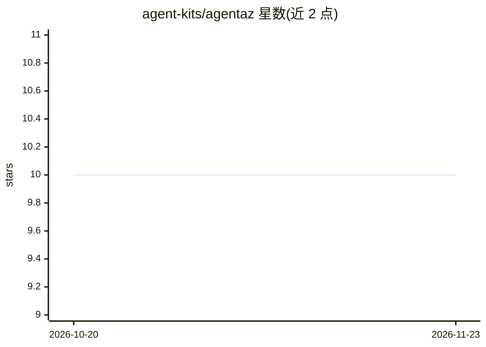

# agent-kits/agentaz

⭐ 10 · Python · Apache-2.0 · 推送 2026-07-02 · [GitHub](https://github.com/agent-kits/agentaz) · [官网](https://agent-kits.com) · 组织维护

**AI agent 设计时治理规范与 62 份蓝图登记册**

一份设计时（design-time）治理规范：在 agent 上线前，用统一词汇记录其权限范围、Trust Level、最坏动作与升级路径，生成可 review、可 diff 的 agentaz.json 文件交给安全/合规团队。仓库含规范、62 份参考蓝图（13 份旗舰）、JSON Schema（draft-07）、GitHub Action 校验器及到 NIST AI RMF / ISO 42001 / OWASP Agentic 的映射。规范本身不执行任何东西，执行仍由运行时完成；仓库由 AgentKits 上游单向生成发布。

## 筛选速览

| 维度 | 判定 | 备注 |
|---|---|---|
| AI 角色 | `ai-ecosystem` | LLM/agent 周边工具 |
| 许可风险 | `permissive` | Apache-2.0 |
| 部署形态 | `None` |  |
| 模型依赖 | — | README 未给出锁定关系 |
| 硬件要求 | — | 无带数字的原话,不猜 |
| 安装摩擦 | `low` | 无编译、无系统依赖或容器化 |
| 成熟度 | `idea` | |

## 能力要点

- 62 份参考蓝图，均带 Trust Level 与书面化的 worst-case action
- machine-readable agentaz.json，通过 v1.0.0 JSON Schema 校验
- agentaz-validate GitHub Action 在每次 push/PR 计算信任级别并可阻断
- CROSSWALK.md 映射 NIST AI RMF、ISO 42001、OWASP Agentic

## 适用场景

- agent 上线前向安全或合规团队提交可审查的权限声明
- 在 CI 中拦截风险超出策略阈值的 agent 变更
- 参考蓝图模板为自己的 agent 编写治理文档

## 场景标签

 · 领域:AI agent 治理/开发规范

## 证据(README 行号)

> L6: AgentAz is design-time only. It doesn't run anything or wrap your code; it's a vocabulary for
> L30: - **Enforce it in CI** — add the `agentaz-validate` GitHub Action to any repo; it computes the Trust Level on every

## 星数曲线

2026-10-20 10 → 2026-11-23 10（+0）

---
*卡片 v1 · prompt 1.4 · 生成 2026-11-20 · 置信度 high · 依据 README sha `39648f5a91fb` · [字段定义](../../DATASET.md)*
