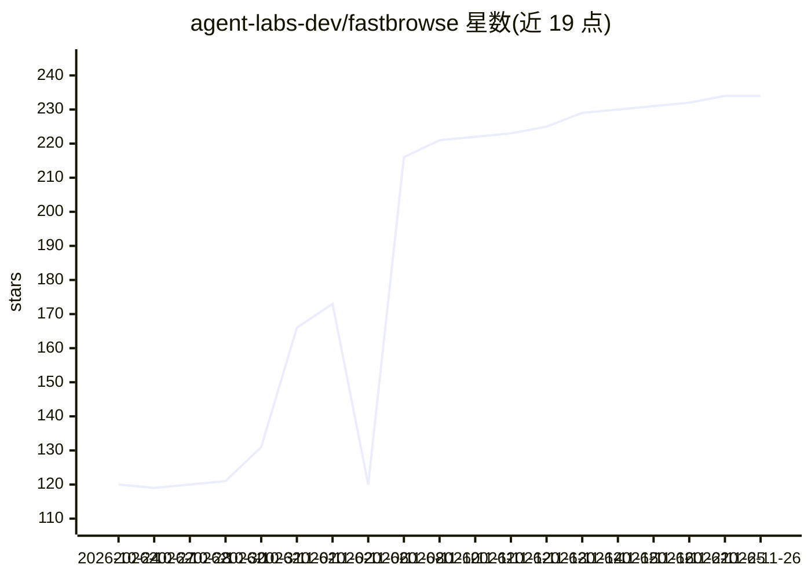

# agent-labs-dev/fastbrowse

⭐ 234 · Rust · MIT · 推送 2026-11-25 · [GitHub](https://github.com/agent-labs-dev/fastbrowse) · 组织维护

**给 Agent 配浏览器的命令行工具：操作页面并给出带引文的答案**

浏览器自动化 Agent：将页面索引为其真实存在的控件，由选择模型 Jev 从中挑选动作并规划，LLM 负责起始地址提议与答案撰写；答案中每条声明附带页面原文引文和定位链接，传入 schema 可返回校验后的数据。提交、支付、删除等不可逆操作由代码门控，密钥仅以名称暴露给模型，支持步数/时间/金额上限。核心用 Rust 实现，提供 CLI、Python 库、Node/Go SDK、MCP server 与编码 agent 技能。

## 筛选速览

| 维度 | 判定 | 备注 |
|---|---|---|
| AI 角色 | `ai-native` | 本体是模型或模型工具 |
| 许可风险 | `permissive` | MIT |
| 部署形态 | `library` | 以包/库形式分发 |
| 模型依赖 | locked-api |  |
| 硬件要求 | — | 无带数字的原话,不猜 |
| 安装摩擦 | `medium` | 含编译或系统依赖之一 |
| 成熟度 | — | 结构信号不足 |

## 能力要点

- 页面控件索引 + Jev 选择模型，只点击页面实际存在的控件
- 答案逐条声明附页面逐字引文与定位链接
- 代码级门控：不可逆操作需 --authorize，密钥按来源绑定
- CLI、Python 库、Node/Go SDK、MCP server、编码 agent 技能多种接口

## 适用场景

- 让 agent 在我已登录的 Chrome 里完成下单、填表等网页任务
- 对整列页面批量提取数据并保留每条出处
- 需要每个结论都能回溯到页面原文的可核查回答

## 场景标签

`浏览器自动化` · 领域:效率与自动化

## 证据(README 行号)

> L5: A browser agent that picks from the controls a page actually has, cites the page for every claim, and keeps
> L30: - **One agent, every interface.** A CLI, a Python library, Node and Go SDKs that need no Python, an MCP
> L56: export OPENROUTER_API_KEY=...   # Jev, the model that picks each action, and the LLM for start pages, written field

## 星数曲线

2026-10-24 120 → 2026-11-26 234（+114）

---
*卡片 v1 · prompt 1.4 · 生成 2026-11-25 · 置信度 high · 依据 README sha `9658e1e225f1` · [字段定义](../../DATASET.md)*
