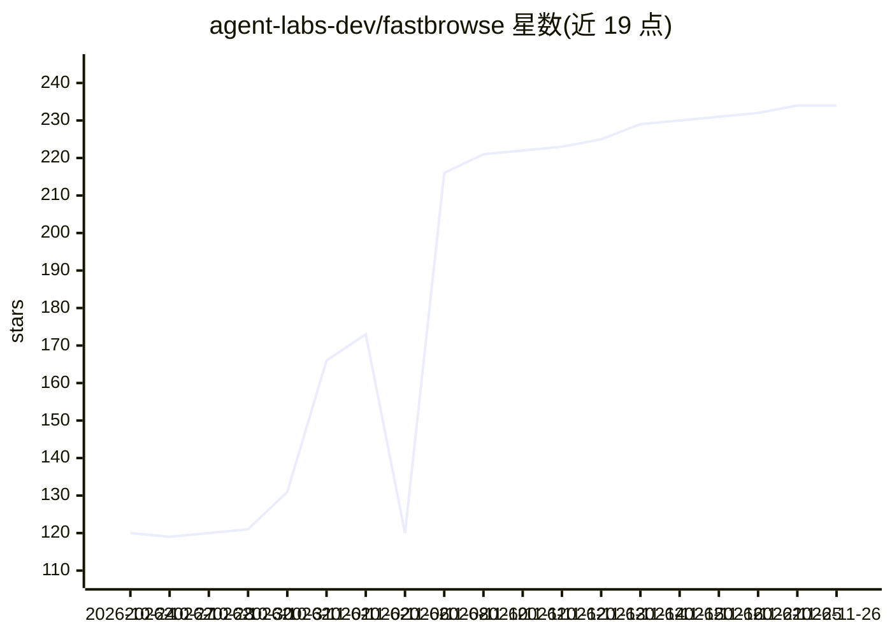

# agent-labs-dev/fastbrowse

⭐ 234 · Rust · MIT · 推送 2026-11-25 · [GitHub](https://github.com/agent-labs-dev/fastbrowse) · 组织维护

**面向开发者的浏览器 agent：LLM 从页面控件中选动作并引用页面作答**

一个浏览器自动化 agent：将页面索引为编号控件，由 LLM 每轮指名要执行的动作，代码负责把关不可逆操作、凭据与预算。回答中每条声明都附带页面原文引用与跳转链接；传入 schema 可返回校验后的数据。提供 CLI、Python 库、Node/Go SDK、MCP server 与编码 agent 技能。默认在用户已登录的 Chrome 中经扩展运行，也可用 --cloud 走 Browser Use Cloud；需 OpenRouter API key，核心为 Rust 实现。

## 筛选速览

| 维度 | 判定 | 备注 |
|---|---|---|
| AI 角色 | `ai-native` | 本体是模型或模型工具 |
| 许可风险 | `permissive` | MIT |
| 部署形态 | `library` | 以包/库形式分发 |
| 模型依赖 | locked-api |  |
| 硬件要求 | — | 无带数字的原话,不猜 |
| 安装摩擦 | `medium` | 含编译或系统依赖之一 |
| 成熟度 | — | 结构信号不足 |

## 能力要点

- 页面索引为编号控件，LLM 只能从页面实际存在的动作中挑选，无选择器需维护
- 答案中每条声明引用页面原句并带滚动定位链接
- 代码把关提交/支付/删除等不可逆操作，密钥只按名称传给模型
- CLI、Python 库、Node/Go SDK、MCP server 与编码 agent 技能多种接口

## 适用场景

- 让 agent 在自己登录的 Chrome 中完成签购、下单等站点操作
- 对整个列表页逐页翻页并保留引用地抽取结构化数据
- 以编程限速与授权门槛安全地自动化含付费/提交动作的网页任务

## 场景标签

`浏览器自动化` `网页抓取` · 领域:效率与自动化

## 证据(README 行号)

> L3: **Give your agent a browser.**
> L5: A browser agent that picks from the controls a page has, cites the page for every claim, and keeps
> L29: - **One agent, every interface.** A CLI, a Python library, Node and Go SDKs that need no Python, an MCP

## 星数曲线

2026-10-24 120 → 2026-11-26 234（+114）

---
*卡片 v1 · prompt 1.4 · 生成 2026-11-26 · 置信度 high · 依据 README sha `badb4ba16349` · [字段定义](../../DATASET.md)*
