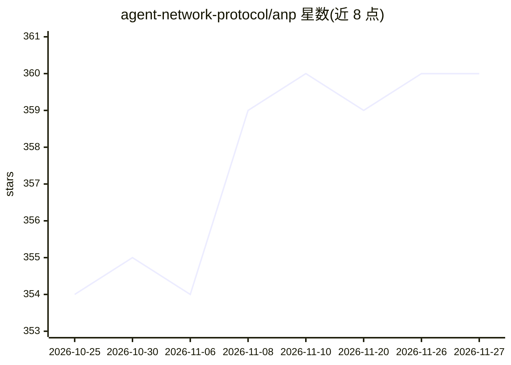

# agent-network-protocol/anp

⭐ 360 · Rust · Apache-2.0 · 推送 2026-11-13 · [GitHub](https://github.com/agent-network-protocol/anp) · [官网](https://agent-network-protocol.com/) · 组织维护 · 中文 README

**为智能体提供互联通信能力的多语言协议 SDK**

AgentConnect 是 Agent Network Protocol（ANP）的多语言 SDK 与参考实现，覆盖 Python、Go、Rust、Dart、TypeScript、Java。它让 agent 之间完成身份识别（DID WBA）、发布可发现接口（Agent Description/OpenRPC）、经 JSON-RPC 互调、附加可验证证明、解析可读句柄（WNS）以及端到端加密通信。面向构建 agent 互联应用的开发者；Java 版为本地 Maven 构建，LLM 协商示例需 .env 配置 LLM provider。

## 筛选速览

| 维度 | 判定 | 备注 |
|---|---|---|
| AI 角色 | `ai-ecosystem` | LLM/agent 周边工具 |
| 许可风险 | `permissive` | Apache-2.0 |
| 部署形态 | `library` | 以包/库形式分发 |
| 模型依赖 | — | README 未给出锁定关系 |
| 硬件要求 | — | 无带数字的原话,不猜 |
| 安装摩擦 | `low` | 无编译、无系统依赖或容器化 |
| 成熟度 | — | 结构信号不足 |

## 能力要点

- DID WBA 身份认证与 W3C Data Integrity 证明体系
- OpenANP 将 Python 方法自动生成 ad.json、OpenRPC 接口与 JSON-RPC 端点
- Direct/Group E2EE（HPKE/MLS）加密通信模块
- AP2 支付协议 mandate 模型与 WNS 句柄解析

## 适用场景

- 让多个 agent 互相发现接口并通过标准 RPC 调用
- 为 HTTP 服务添加 DID WBA 去中心化身份认证
- 实现 agent 间端到端加密私聊与群聊
- 探索 agent 间支付授权流程（AP2）

## 场景标签

`Agent 框架` `多智能体` · 领域:Agent 开发

## 证据(README 行号)

> L5: AgentConnect is the multi-language SDK and reference implementation for the Agent Network Protocol (ANP). It helps a
> L15: ANP is a protocol stack for an open network of interoperable agents. In practice, it answers these questions:

## 星数曲线

2026-10-25 354 → 2026-11-27 360（+6）

---
*卡片 v1 · prompt 1.4 · 生成 2026-11-25 · 置信度 high · 依据 README sha `39472c1f4c96` · [字段定义](../../DATASET.md)*
