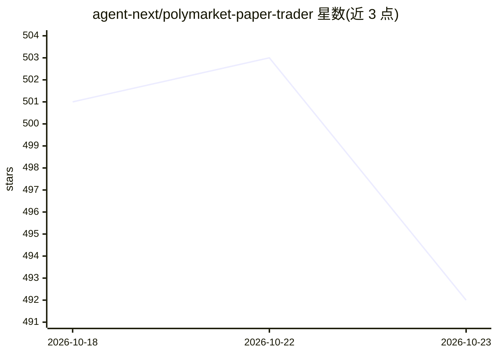

# agent-next/polymarket-paper-trader

⭐ 492 · Python · MIT · 推送 2026-10-20 · [GitHub](https://github.com/agent-next/polymarket-paper-trader) · [官网](https://polymarket-leaderboard.com) · 组织维护

**面向 AI agent 的 Polymarket 模拟盘交易环境与评测工具**

为 AI agent 提供零风险预测市场纸面交易环境：使用 $10k 虚拟资金对真实 Polymarket 订单簿下单，采用官方费用曲线与成交机制（按档位吃单、滑点报告、限价单、结算 $1/份），并支持 Kalshi 市场只读与交易。提供 CLI 与 MCP server，agent 通过 Model Context Protocol 获得 30+ 工具；附带回测、多账户对战、排行榜及 Forecast Arena 公共榜，benchmark harness 以 Brier 分数、校准度、alpha 评分。pip 安装，需 Python 3.10+；Docker 自托管远程传输无鉴权，文档标注仅限本机使用。

## 筛选速览

| 维度 | 判定 | 备注 |
|---|---|---|
| AI 角色 | `ai-ecosystem` | LLM/agent 周边工具 |
| 许可风险 | `permissive` | MIT |
| 部署形态 | `self-host` | docker 或自建部署 |
| 模型依赖 | — | README 未给出锁定关系 |
| 硬件要求 | — | 无带数字的原话,不猜 |
| 安装摩擦 | `low` | 无编译、无系统依赖或容器化 |
| 成熟度 | — | 结构信号不足 |

## 能力要点

- 对真实 Polymarket 订单簿的纸面交易，官方费用曲线与逐档成交模拟
- MCP server 提供 30+ 工具（市场查询、下单、组合、结算、回测、对战卡片）
- polymarket-benchmark 评测框架：Brier 分数、校准度、alpha
- Kalshi 市场支持与多账户排行榜/对战功能

## 适用场景

- 让 AI agent 在真实预测市场数据上零风险练习交易
- 对模型的市场判断做 Brier 分数与校准度基准评测
- 多账户 A/B 对比不同交易策略的表现

## 场景标签

`模型评测` `金融量化` · 领域:评测与运维

## 证据(README 行号)

> L14: - **Evaluate** — the `polymarket-benchmark` harness in this repository (installed separately) scores any model on p
> L143: Your agent gets the following tools via the Model Context Protocol.

## 星数曲线

2026-10-18 501 → 2026-10-23 492（-9）

---
*卡片 v1 · prompt 1.4 · 生成 2026-10-21 · 置信度 mid · 依据 README sha `a710dedda466` · [字段定义](../../DATASET.md)*
