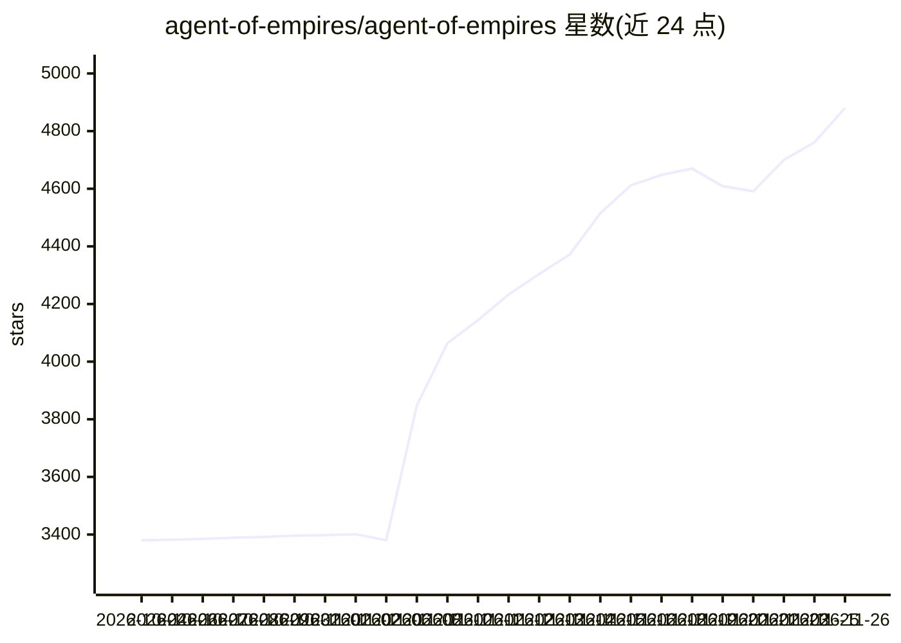

# agent-of-empires/agent-of-empires

⭐ 4,880 · Rust · MIT · 推送 2026-11-25 · [GitHub](https://github.com/agent-of-empires/agent-of-empires) · [官网](http://www.agent-of-empires.com/) · 组织维护

**多 AI 编码 agent 的会话管理器：TUI/Web 并行监控**

面向 Linux/macOS 的 AI 编码 agent 会话管理器：将 Claude Code、Codex CLI、Gemini CLI 等多个 agent 运行在 tmux 持久会话或持久 worker 中，支持跨分支并行运行、TUI/浏览器/手机端监控、SSH 断线后会话保持，可选 git worktree 与 Docker/Podman/Apple Containers 沙箱隔离。提供 TUI、Web、CLI 与 HTTP API 四种访问面，含状态检测、通知、diff 审查与自定义 agent 命令。

## 筛选速览

| 维度 | 判定 | 备注 |
|---|---|---|
| AI 角色 | `ai-ecosystem` | LLM/agent 周边工具 |
| 许可风险 | `permissive` | MIT |
| 部署形态 | `None` |  |
| 模型依赖 | — | README 未给出锁定关系 |
| 硬件要求 | — | 无带数字的原话,不猜 |
| 安装摩擦 | `low` | 无编译、无系统依赖或容器化 |
| 成熟度 | — | 结构信号不足 |

## 能力要点

- 多 agent 并行运行于 tmux 持久会话，断线/关终端后保持运行
- TUI、Web 仪表盘、CLI、HTTP API 四种访问面，支持手机访问
- Docker/Podman/Apple Containers 沙箱隔离与 git worktree 管理
- diff 审查、profiles、repo hooks 与自定义 agent 命令

## 适用场景

- 同时管理多个分支上的 AI 编码 agent 会话
- 在手机浏览器上查看和控制运行中的 agent
- SSH 远程开发时保持 agent 会话不断线

## 场景标签

 · 领域:开发工具/Agent 编排

## 证据(README 行号)

> L20: A session manager for AI coding agents on Linux and macOS. Run agents in
> L38: - TUI, web, CLI, and HTTP API surfaces
> L39: - Status detection, notifications, and persistent tmux sessions

## 星数曲线

2026-10-24 3,380 → 2026-11-26 4,880（+1,500）

---
*卡片 v1 · prompt 1.4 · 生成 2026-11-26 · 置信度 high · 依据 README sha `8fa079387aa1` · [字段定义](../../DATASET.md)*
