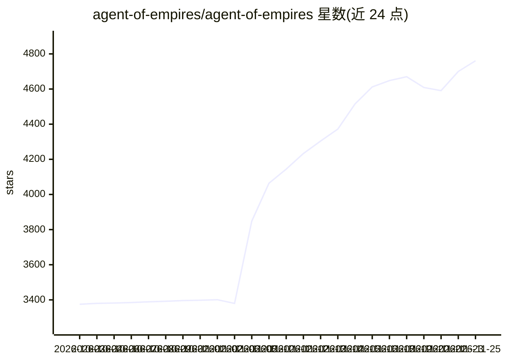

# agent-of-empires/agent-of-empires

⭐ 4,761 · Rust · MIT · 推送 2026-11-24 · [GitHub](https://github.com/agent-of-empires/agent-of-empires) · [官网](http://www.agent-of-empires.com/) · 组织维护

**多 AI 编码 agent 的会话管理器：TUI/Web 并行管理**

面向 Linux 与 macOS 的 AI 编码 agent 会话管理器：让 Claude Code、OpenCode、Codex CLI、Gemini CLI 等多个 agent 在不同分支上并行运行，每个 agent 位于持久 tmux 会话或持久 worker 中，支持可选的 git worktree 与容器（Docker/Podman/Apple Containers）隔离；提供 TUI、Web 仪表盘、CLI 与 HTTP API 四种入口，支持手机浏览器访问、状态检测、通知、diff 审查与 profile/repo hooks。依赖 tmux 与 POSIX 进程处理，Windows 仅可通过 WSL2 使用。安装提供 Homebrew、安装脚本、Nix 与源码构建。

## 筛选速览

| 维度 | 判定 | 备注 |
|---|---|---|
| AI 角色 | `ai-ecosystem` | LLM/agent 周边工具 |
| 许可风险 | `permissive` | MIT |
| 部署形态 | `None` |  |
| 模型依赖 | — | README 未给出锁定关系 |
| 硬件要求 | — | 无带数字的原话,不猜 |
| 安装摩擦 | `low` | 无编译、无系统依赖或容器化 |
| 成熟度 | — | 结构信号不足 |

## 能力要点

- TUI/Web/CLI/HTTP API 四种管理入口，支持手机访问
- tmux 持久会话，SSH 断开或终端崩溃后 agent 持续运行
- git worktree 多仓库工作区与 Docker/Podman/Apple Containers 沙箱隔离
- agent 状态检测、通知与 diff 审查

## 适用场景

- 同时并行运行多个 AI 编码 agent 处理不同分支
- 通过手机浏览器查看和监控远程 agent 会话
- 用容器沙箱隔离 agent 的执行环境

## 场景标签

`编码 Agent` `Agent 框架` · 领域:Agent 开发

## 证据(README 行号)

> L23: A session manager for AI coding agents on Linux and macOS. Run agents in
> L41: - TUI, web, CLI, and HTTP API surfaces

## 星数曲线

2026-10-23 3,375 → 2026-11-25 4,761（+1,386）

---
*卡片 v1 · prompt 1.4 · 生成 2026-11-24 · 置信度 high · 依据 README sha `a7e787780f04` · [字段定义](../../DATASET.md)*
