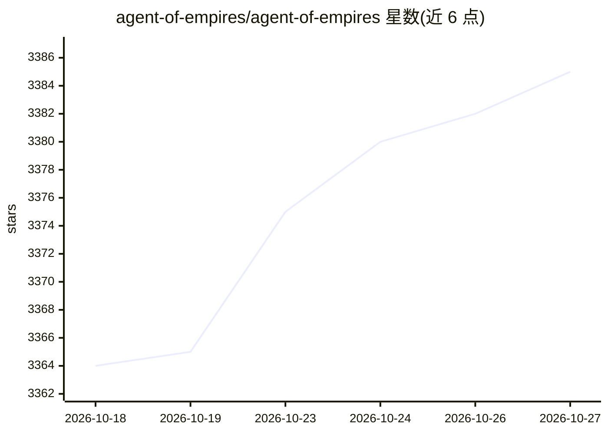

# agent-of-empires/agent-of-empires

⭐ 3,385 · Rust · MIT · 推送 2026-10-26 · [GitHub](https://github.com/agent-of-empires/agent-of-empires) · [官网](http://www.agent-of-empires.com/) · 组织维护

**AI 编码代理的会话管理器：TUI/Web 并行管理多个 agent**

面向 Linux/macOS 开发者的 AI 编码代理会话管理工具：为 Claude Code、OpenCode、Codex CLI、Gemini CLI、Mistral Vibe 等代理各建持久 tmux 会话，支持跨分支并行运行、TUI/Web/CLI/HTTP API 多界面、手机浏览器访问。机制上依赖 tmux 保持会话（关闭 TUI 或断开 SSH 后代理继续运行），可选 git worktree 与 Docker/Podman/Apple Containers 沙箱隔离，并提供状态检测、diff 审阅与通知。安装经 Homebrew 或脚本；Windows 仅支持 WSL2。

## 筛选速览

| 维度 | 判定 | 备注 |
|---|---|---|
| AI 角色 | `ai-ecosystem` | LLM/agent 周边工具 |
| 许可风险 | `permissive` | MIT |
| 部署形态 | `None` |  |
| 模型依赖 | — | README 未给出锁定关系 |
| 硬件要求 | — | 无带数字的原话,不猜 |
| 安装摩擦 | `low` | 无编译、无系统依赖或容器化 |
| 成熟度 | — | 结构信号不足 |

## 能力要点

- 每个代理运行于独立持久 tmux 会话，跨 SSH 断连保持
- TUI、Web 仪表盘（含手机访问）、CLI 与 HTTP API 多界面
- git worktree、多仓库工作区与 Docker/Podman/Apple Containers 沙箱
- 状态检测、通知与 diff 审阅

## 适用场景

- 在多个分支上并行运行多个 AI 编码代理
- 手机浏览器远程查看代理状态与 diff
- 用容器沙箱隔离代理的代码操作

## 场景标签

 · 领域:开发者工具/AI 编码代理管理

## 证据(README 行号)

> L19: A session manager for AI coding agents on Linux and macOS. Run agents in
> L37: - TUI, web, CLI, and HTTP API surfaces

## 星数曲线

2026-10-18 3,364 → 2026-10-27 3,385（+21）

---
*卡片 v1 · prompt 1.4 · 生成 2026-10-20 · 置信度 high · 依据 README sha `5861454f6e76` · [字段定义](../../DATASET.md)*
